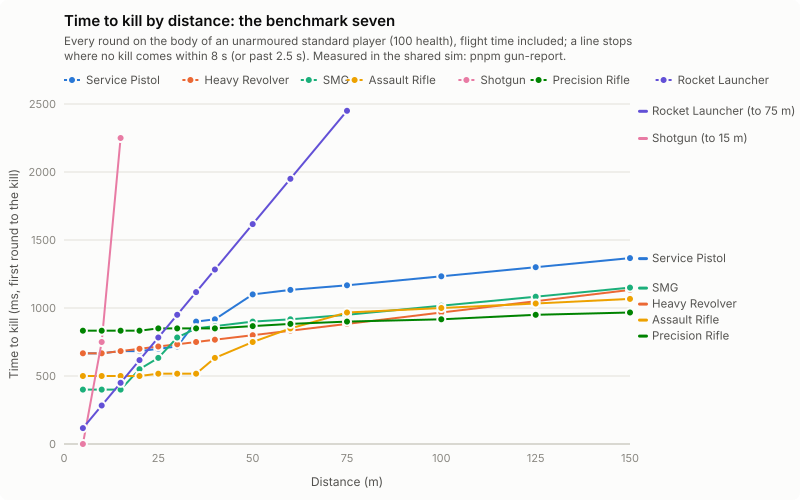

# Gunplay audit: report card (November 2026)

Measured, not tuned: every number below comes from the shared sim (`Match`, the code the server, client prediction
and bots run), driven by `pnpm gun-report` (`packages/server/src/tools/gun-report.ts`) on a flat deck with one shooter
and one standard target (100 health, standard look, no character stats). Machine-readable results:
[gunplay-audit.json](gunplay-audit.json). Judged against [GUNPLAY_DIRECTION.md](GUNPLAY_DIRECTION.md) (arcade
responsiveness + ballistic depth + modern polish; responsiveness > realism) and [GUNPLAY_SPEC.md](GUNPLAY_SPEC.md).
The audit itself changed no weapon (main f1a16d3); **pass 2 (below) tuned candidates 1-6 the same day**, and every
table here, the chart and the JSON are re-measured after it. **Pass 3** (2026-11-09) added the network check (G3) and
bots' weapon ranges from the measurements (G4); it changed no weapon. The October feel pass is in git (78c11a0, cc5c673).

## Pass 2: the tuning of 2026-11-08 (owner-approved candidates 1-6, and the Battle Rifle)

`wip/gunplay-2`. Body TTK, ideal, in seconds (before → **after**); `pnpm gun-report` before and after, the same tool
and settings. Unchanged guns are as in the audit.

| Gun | 5 m | 10 m | 15 m | 20 m | 25 m | 50 m | 100 m | 150 m | hip 25 m |
|---|---|---|---|---|---|---|---|---|---|
| Submachine Gun | .60 → **.40** | .60 → **.40** | .60 → **.40** | .75 → **.55** | .97 → **.63** | 1.17 → **.90** | 1.28 → **1.02** | 1.42 → **1.15** | 3.43 → **.77** |
| Assault Rifle | .50 | .50 | .50 | .50 | .52 | .65 → **.75** | .80 → **1.00** | .87 → **1.07** | .52 |
| Shotgun | 0 | 1.50 → **.75** | 6.32 → **2.25** | – → **6.32** | – | – | – | – | – |
| Sawed-Off | .23 → **0** | 5.13 → **1.63** | – → **3.38** | – | – | – | – | – | – |
| Auto Shotgun | .60 → **.30** | 3.08 → **.60** | – → **4.07** | – | – | – | – | – | – |
| Precision Rifle (`core.sniper`) | 1.25 → **.83** | 1.25 → **.83** | 1.25 → **.83** | 1.25 → **.83** | 1.27 → **.85** | 1.28 → **.87** | 1.33 → **.92** | 1.38 → **.97** | – → **3.85** |
| Marksman Rifle | .47 → **.60** | .47 → **.60** | .47 → **.60** | .47 → **.60** | .48 → **.62** | .50 → **.63** | .57 → **1.00** | .85 → **1.05** | .72 → **1.07** |
| Pulse Pistol | .60 | .60 | .60 | .60 | .60 → **.75** | .60 → **1.35** | .60 → **1.35** | – | .60 → **.75** |
| Burst Rifle (rifle family) | .53 | .53 | .53 | .53 | .55 | .85 → **.92** | .97 → **1.30** | 1.03 → **1.37** | .55 |
| Battle Rifle (new) | **.60** | **.60** | **.60** | **.60** | **.62** | **.83** | **1.10** | **1.15** | **.62** |
| Pistol, Heavy Revolver (for reference) | .67, .67 | .67, .67 | .68, .68 | .68, .70 | .70, .72 | 1.10, .80 | 1.23, .97 | 1.37, 1.13 | .70, 1.05 |

1. **SMG vs Assault Rifle** (data): SMG damage 11 → 15 and its falloff from 15 m (was 12); the rifle family's falloff
   now 25-70 m down to 60 % (was 30-80 m, 75 %). The SMG wins to about 17 m (0.40 s against 0.50 at 5-15 m; hip at
   25 m 0.77 s, was 3.4), the rifle from 20 m. (A wider rifle hip cone, 5 mrad with 1 mrad aimed, was tried and taken
   out: it changes nothing up close, and it stalled the CTF bot matches `botCtf.test.ts` and `forts.test.ts` measure:
   no capture on Sunken Kingdom in five minutes.) Fastest body kill of the seven by range: SMG to 15 m, rifle
   20-50 m, Heavy Revolver 60-75 m, Precision Rifle from 100 m (the rifle 1.00 s at 100 m against 0.92).
2. **Shotguns at room range** (data): the pump shell is 10 × 12 in a 55 mrad pattern (was 75), the family's falloff
   8-28 m (was 6-22): one shell kills a body to 9 m (was 5), two to 12 m. The Sawed-Off 14 × 10 in 85 mrad (was 8 in
   150): one barrel kills to 7 m, both barrels to 9 m (0.23 s); the Auto Shotgun 8 × 8 in 65 mrad (was 7 × 7 in 90):
   two shells to 8 m (0.30 s), three at 10 m (was eight). Past 15 m all three stay hopeless.
3. **Damage numbers** (client option, off by default; Options → HUD): see "Hit feedback" below.
4. **Precision Rifle body case, Pulse Pistol, Marksman** (data): the Precision Rifle hits 90 (was 80) and its bolt
   cycles in 50 ticks (was 75): two body shots in 0.83-0.97 s at every range (was 1.25-1.38), the head still one. The
   Pulse Pistol's beam now falls off (15-45 m to 45 %): it out-paces the Pistol to 20 m (0.60 against 0.67-0.68 s) and
   loses from 35 m (1.35 s at 50-100 m against 1.10-1.23). The Marksman 34 damage (was 38) at 200 rpm (was 257): three
   rounds to 60 m (0.60-0.67 s), four past it (1.00 s at 100 m): the Marksman is the mid-range body killer, the
   Precision Rifle the long one (and the one-shot head).
5. **Reloads** (sim): a quick-melee press breaks a reload where it is, struck or not (the punch already did on the
   host; client prediction now does too, so the HUD no longer shows a reload the host has stopped); **auto-reload**
   (Options → Controls, **on by default**: GUNPLAY_DIRECTION.md "minimal lockout", "fewer moments where input feels
   ignored"): an emptied magazine starts its reload once the gun is ready, without a trigger pull, as an input bit
   (`BUTTON_AUTO_RELOAD`) the host and prediction both read (`autoReloadDue`, gunplay.ts), not while sprinting forward or
   holding quick melee. The Spin Gun's draw 1233 → 933 ms (raise 48 → 30 ticks; the spin-up is unchanged).
6. **Recoil readout** (client option, off by default; Options → HUD, "Spray pattern"): a small HUD panel plots where
   your last burst went, round by round (milliradians from the first round, a dashed ring the width of a body at 25 m),
   with the group's spread and how long the aim took to settle. It works at any wall, the Training Range's recoil wall
   included; a board on the map that draws the pattern would need a new MapMaker piece (editor code, the MapMaker
   lane's claim): not done, see HANDOFF.

**Hit feedback.** With damage numbers on, each of your hits floats its damage up from the target for 0.9 s: white on
a body, gold for a head hit, cyan where armour took part, bolder for the kill, and grey on a board, crate or barrel
(the damage that round would do to a body there, falloff included: the Training Range's boards now read out falloff).
The host sums a shotgun shell's pellets into one number. The host sends them only to the shooter, in their private
state (`dd`: tick, amount, flags, position; a few snapshots' worth, the client shows each tick once). They fade, never
flash (Reduce flashing).

**The Battle Rifle** (`core.battle_rifle`, spec gap G2): the `battle_rifle` family (880 m/s, 1800 energy) with 25
damage at 300 rpm, 20 rounds, its own falloff (40-100 m to 75 %), a 1 mrad first shot from the hip, a hard climbing
kick (26-34 mrad a round). Four rounds kill to 40 m (0.60 s), two to the head anywhere (0.20-0.50 s); five at 50 m,
six past 85 m. On paper never the quickest body kill (the rifle and the SMG are, closer; the Precision Rifle further),
its case is the true first shot (hip at 25 m equals its ideal, 0.62 s), two head hits anywhere and penetration;
through armour it is slower than the rifle (1.40 s at 10 m against 1.10). Model: the Meshy Community Frontier Rifle (already built, unused);
slot 3, rifle ammo, the Military set and the Training Range's front rack (x -2, z 20). **Lever action: not made**: the
Frontier Rifle is a scoped modern rifle, not a lever gun, and no lever-action model is in the repo or the Drive (see
HANDOFF for the proposal).

**Reading the numbers.** TTK runs from the first round leaving the barrel to the kill: flight time, reloads and
burns count. *Ideal* puts every round where it is aimed (the gunplay cone off; a shotgun keeps its pattern), with
perfect tracking, full recoil counter and drop held over. *Hip* and *ADS* use the real cone (standing still), same
perfect tracking and counter, median of 8 seeds; "–" = no kill within 8 s in most seeds. Shots to kill (STK) are the
fewest rounds that kill. Armoured = full armour (100, takes two thirds of each hit). Distances in metres, times in
seconds unless marked.

## G3: the network check (candidate 7, 2026-11-09)

`wip/gunplay-3`. `pnpm net-report` (`packages/server/src/tools/net-report.ts`, the lab in `netLab.ts`) runs a real
host, the dedicated server (`server.ts`, the code the Host Service runs), with 8 players joined over the real wire
path (`peerConn`: one deflate stream per link, the same messages, the snapshot deltas). Each player runs the
browser's own netcode (`client/src/game`: the Interpolator and its server clock, LocalPlayer prediction and
reconciliation, the SnapshotCoalescer). Only the WebRTC data channel is replaced, by a link with latency, jitter and
loss each way. The game's channels are reliable and ordered (SCTP), so a lost packet is resent about a round trip
and three packet gaps later, and everything behind it waits (head-of-line blocking). Bandwidth is not limited.

The players are bots driving the client through its inputs, as a person would. Free-for-all on a flat open 64 m
deck, everyone with the Assault Rifle. Each bot strafes and now and then jumps at 8-25 m, aims at a random point on
the nearest body its screen draws, and taps the trigger. Ammunition is topped up so firing never stops.

Each round is judged twice, both times along the host's own path for it (its eye and its spread):
- **on the screen**: against the bodies as the shooter's screen drew them at that moment and the ticks after, as the
  round flies;
- **on the host**: the host's verdict, from its lag-compensated rewind.

The two verdicts can only differ by where each had the bodies. Results: [gunplay-net.json](gunplay-net.json).
`pnpm net-report --conditions=100/20/2 --seconds=30 --clients=8 [--weapon=core.pistol]` runs one condition;
`--smoke` runs a short check. CI runs only a 6-second, 4-player smoke run (`server/test/netLab.test.ts`, at
100/20/2). The full run takes about 5 minutes and is manual.

Round trip is the ping before jitter; jitter adds 0 to that many ms of queueing delay each way; loss is per packet
each way. 30 s a condition, 8 players. The numbers are after the input-queue fix below.

| Condition (RTT / jitter / loss) | Ping p50 / p95 | Screen hits the host confirmed | Missed: target already dead on host / rewind clamped / other | Lag-comp error p50 / p95 | Trigger to hit marker p50 / p95 | Rubber-banding (corrections a player-minute, largest) | Down / up per player |
|---|---|---|---|---|---|---|---|
| 0 / 0 / 0 % | 3 / 7 ms | 353 of 368 (95.9 %) | 10 / 0 / 5 | 1 / 5 cm | 27 / 42 ms | 0 | 2.9 / 8.0 KB/s |
| 50 ms / 10 / 1 % | 62 / 130 ms | 347 of 368 (94.3 %) | 15 / 0 / 6 | 2 / 9 cm | 85 / 180 ms | 0 | 2.9 / 8.0 KB/s |
| 100 ms / 20 / 2 % | 126 / 315 ms | 318 of 363 (87.6 %) | 27 / 14 / 4 | 2 / 8 cm | 153 / 328 ms | 0 | 2.9 / 8.1 KB/s |
| 150 ms / 30 / 3 % | 206 / 532 ms | 261 of 389 (67.1 %) | 46 / **82** / 0 | 2 / 9 cm | 223 / 451 ms | 0 | 2.9 / 8.3 KB/s |
| 150 ms / 30 / 5 % | 310 / 630 ms | 246 of 408 (60.3 %) | 37 / **124** / 1 | 2 / 10 cm | 343 / 622 ms | 0.5 (26 cm) | 2.8 / 8.4 KB/s |
| 250 ms / 30 / 2 % | 304 / 639 ms | 193 of 473 (40.8 %) | 44 / **236** / 0 | – (all clamped) | 324 / 680 ms | 2 (64 cm) | 3.2 / 8.6 KB/s |

Also measured:
- **Hits the host gave that the screen missed:** 1-7 a condition (of about 450 rounds).
- **Rounds the client fired that the host never did:** 2-57 a condition. Almost all came from a shooter the host
  already had dead (a trade). With the fix below, only 0-8 were not trades.
- **Corrections after being hit:** 51-70 a player-minute, p95 7 cm (no latency) to 46 cm (150 ms, 5 %). Stopping power
  shoves the body on the host (spec §23) and no client predicts it. This is by design; the report lists it apart.
- **Host tick:** about 0.3 ms.
- **The lab's own stalls:** p99 14-22 ms. Everything shares one process, so these delay every link a little.

**What holds up.**
- **Lag compensation is accurate:** where the host rewound a body to against where the screen drew it, p95 5-10 cm
  at every condition the rewind covers. That is well under a body's width: "lead for travel, never for latency"
  holds.
- **Rounds the host fires agree with the screen:** at 50-100 ms, 94-88 % of screen hits are confirmed.
  - Most of the rest are on a target the host already had dead: someone else got the kill first. No netcode can fix
    that.
  - The other misses are 1-2 %: grazing hits on a body's edge.
- **Phantom hits are rare:** under 2 % of rounds.
- **Prediction is exact:** no corrections at all except after being hit, and after the loss bursts covered below.
- **Bandwidth is small:** about 3 KB/s down and 8 KB/s up a player on this deck.
  - Players send their inputs as plain JSON every frame (about 130 bytes, 60 a second), so up is the larger.
  - Down grows with the match. `tools/perf/host96.mjs` measures it at 96 players.

**Fixed (small, with a test).** The host's input queue dropped a resent packet's burst.
- **The bug:** a lost packet holds every input behind it until it is resent. The inputs then arrive together: 15-25 of
  them at 150-250 ms. The host kept 16 (`MAX_QUEUED_INPUTS`, about 267 ms) and dropped the oldest.
- **What the player saw:** each dropped input was a step their prediction took and the host didn't, so they snapped
  back (up to 1.4 m). A round they saw leave was never fired.
- **The fix:** the queue now holds 32 (`shared/src/sim/match.ts`). Speed hacks are still capped by the two inputs a
  tick the host applies.
- **The test:** `match.test.ts`, "keeps the burst of inputs a resent packet releases".

Same tool and settings, 25 s, before → after:

| Condition | Inputs dropped | Corrections a player-minute (largest) | Rounds not fired (not trades) |
|---|---|---|---|
| 150 ms / 30 / 3 % | 64 → 8 | 0.6 (95 cm) → 0 | 4 → 0 |
| 150 ms / 30 / 5 % | 267 → 9 | 2.7 (139 cm) → 0.3 (12 cm) | 10 → 0 |
| 250 ms / 30 / 2 % | 717 → 7 | 16.5 (99 cm) → 0.6 (50 cm) | 29 → 2 |

**For the owner (not changed).**
1. **The rewind window is too short past about 120 ms of ping.**
   - **The cause:** the host rewinds at most `MAX_REWIND_TICKS` = 18 ticks (300 ms). A shot needs its ping, plus the
     100 ms players are drawn behind (INTERP_DELAY_TICKS), plus jitter and any resend.
   - **What it costs:** at 150 ms with 30 ms jitter, 21-30 % of screen hits fall outside the window and miss, and at
     250 ms nearly all do. Players then have to lead for latency, which the spec rules out (§38).
   - **Measured with 30 ticks (500 ms)**, same runs, 25 s:

     | Condition | 18 ticks | 30 ticks |
     |---|---|---|
     | 150 ms / 30 / 3 % | 66.8 % confirmed | 85.8 % |
     | 150 ms / 30 / 5 % | 56.4 % | 78.1 % |
     | 250 ms / 30 / 2 % | 38.2 % | 72.1 % |

   - **The cost of more:** a player on a slow link can hit someone who has already reached cover, up to half a second
     ago on the victim's screen.
   - **Suggested:** 27-30 ticks (450-500 ms), or a host rule ("max rewind").
   - **Your decision:** it is a fairness call between the shooter and the victim.
2. **The view tick stops at the newest snapshot when a snapshot is late.**
   - **The cause:** while a snapshot is late the screen draws remote players up to 5 ticks past the newest one
     (extrapolating), but the input's view tick stops at that snapshot (`interpolation.ts` renderTick). The host then
     rewinds to a pose the screen isn't drawing.
   - **What it costs:** those shots (1-3 % of rounds) err by 27-61 cm p95 (over several runs), against about 10 cm otherwise.
   - **Tried:** sending the drawn tick instead. It cut that error at 100 ms (39 → 14 cm) and was mixed at 150 ms/5 %.
     Registration was within the run-to-run noise, so it was left as is.
   - **Next:** worth a longer run before changing the client.
3. **Upstream:** inputs as plain JSON (about 8 KB/s a player) could be packed or deflated like the host's stream. That
   is about 2 Mbit/s into a 32-player host. Not a problem on today's connections; noted.
4. **Not covered by the lab:**
   - real WebRTC congestion control, bandwidth limits and TURN;
   - vehicles and explosives (the bots fire the rifle only);
   - real maps: the deck is flat and open, and the clients' bots don't navigate;
   - 16-32 players. Run `--clients=16` for a quick look; the one process then stalls more. Bandwidth and load at 96
     players are host96's.

## G4: bots' weapon ranges from the measured TTK (candidate 8, 2026-11-09)

`wip/gunplay-3`. Bots used to choose and place their guns by hand-set `botRange` values. Some of those were well
off: the Machine Pistol was set to 0-14 m though it needs 16 rounds at 10 m, and the guided launchers to 10-60 m.
Now the ranges come from the time to kill measured in the shared sim.

**How the data is made.**
- `pnpm gun-report` also sweeps each gun's body TTK from 5 to 150 m as bots fire it (`botSweep` in
  [gunplay-audit.json](gunplay-audit.json)).
  - Bots fire from the hip, except that a scoped gun is aimed past 7 m (as `brain.ts` zooms).
  - Each value is the median over the trials, with the real spread.
- `--bands` writes the curves to `shared/src/bots/weaponBands.generated.ts`.
- `shared/src/bots/weaponBands.ts` works out two things from those curves; nothing is copied by hand.

**Band: where a gun kills in good time** (`botBand`).
- It is the run of distances around the gun's quickest kill where it still kills within the slack: at most 1.6 times
  as long, or 0.5 s longer, whichever is more; never over 2.5 s; anything under 0.8 s counts.
- A launcher whose blast hurts its shooter starts outside that blast.
- `weaponScore` (which gun to hold) gives a gun in its band the bonus the hand-set range used to.
- Guns with no curve keep `botRange`: melee, tools, the Flare Gun, the Oil Slicker and the Singularity Cannon.

**Edge at the distance** (`ttkEdge`, also in `weaponScore`).
- This is the gun's TTK at the actual distance against the benchmark seven's median there: +1 to -1, weighted 0.4.
- **Why it is needed:** a band only says a gun can kill there, and a Precision Rifle (0.83 s from the muzzle) and a
  shotgun (one shell) are both in band at 2 m. Without it, a sniper-minded bot kept its rifle at arm's length
  (`weapons.test.ts`, "pick weapons by range").

**Preferred distance** (`botEdge`, for `preferredRange`, how far to fight).
- It is the band from the first two-in-a-row distances where the gun kills at least as fast as the benchmark median.
- **Why:** a flat-curve long gun can kill at the muzzle, but everyday guns beat it there. With the band alone,
  Precision Rifle bots walked into close fights: the first try gave Team Deathmatch 31.4 → 28.9 kills a minute.

Bands, hand-set → measured:

| Gun | Hand-set range | Band | Fights from |
|---|---|---|---|
| Pistol | 2-25 | 0-45 | 7.5 m |
| Assault Rifle | 4-35 | 0-87.5 | 0 m |
| Shotgun | 0-9 | 0-12.5 | 0 m |
| Precision Rifle | 18-120 | 0-150 | 27.5 m |
| SMG | 0-18 | 0-27.5 | 0 m |
| Machine Pistol | 0-14 | 0-12.5 | 0 m |
| Marksman Rifle | 12-90 | 0-137.5 | 7.5 m |
| Battle Rifle | 8-70 | 0-55 | 7.5 m |
| Heavy Revolver | 3-40 | 0-27.5 | 7.5 m |
| Rocket Launcher | 7-40 | 6-27.5 | 6 m |
| Guided Rocket | 10-60 | 6-17.5 | 6 m |
| Laser Rifle | 3-40 | 0-87.5 | 27.5 m |

**Measured with `pnpm bot-report`, before → after.** 28 matches of 150 s each, seeds 1 and 2:
- Team Deathmatch on fernwood_moon, riot_junction, halcyon_station and shingle_point, in the Standard and Military
  sets;
- Deathmatch on concrete_annex and pump_tower, in the Standard and Sci-fi sets;
- CTF on diamond_park and eagle_spires.

| Measure | Before | After |
|---|---|---|
| Kills a minute (all) | 32.7 | 32.0 |
| Kills a minute: TDM / DM / CTF | 31.4 / 35.3 / 33.0 | 30.0 / 34.7 / 34.8 |
| Engagement (mean hit distance) | 17.0 m | 17.4 m |
| Weapon use spread (bots' rounds by weapon, 0..1) | 0.568 | 0.555 |
| Stuck a bot-minute | 1.04 | 1.00 |
| Idle out of a fight | 4.5 % | 4.1 % |
| Frozen | 0.4 % | 0.3 % |
| 10 s+ idle spells a match | 0.6 | 0.6 |
| Failed searches, no-route idle | 0, 0.01 % | 0, 0 % |

`pnpm bot-report --check` (bot-limits.json): every limit held, before and after.

Hit rate and mean hit distance by gun, before → after (bots' rounds):

| Gun | Rounds | Hit % | Hit distance (m) |
|---|---|---|---|
| Assault Rifle | 21942 → 23544 | 12 → 12 | 12.5 → 12.0 |
| Pistol | 17172 → 16204 | 11 → 10 | 8.3 → 8.3 |
| SMG | 4893 → 3411 | 22 → 20 | 7.9 → 8.5 |
| Burst Rifle | 2088 → 1957 | 16 → 18 | 12.7 → 10.9 |
| Marksman Rifle | 1228 → 1179 | 8 → 13 | 17.4 → 12.6 |
| Shotgun | 319 → 355 | 55 → 73 | 10.4 → 8.5 |
| Laser Rifle | 1213 → 309 | 33 → 38 | 11.7 → 9.5 |
| Precision Rifle | 205 → 247 | 8 → 11 | 20.2 → 14.4 |
| Railgun | 125 → 180 | 18 → 39 | 37.4 → 19.3 |
| Auto Shotgun | 189 → 153 | 42 → 61 | 13.1 → 8.8 |
| Sawed-Off | 67 → 102 | 45 → 79 | 4.9 → 7.3 |
| Battle Rifle | 284 → 85 | 6 → 21 | 16.5 → 12.4 |
| Pulse Pistol | 284 → 107 | 39 → 29 | 9.1 → 17.1 |
| Machine Pistol | 36 → 0 | 61 → – | 4.1 → – |

**Reading it.**
- **Hit rates:** bots now fire most guns where those guns land. Hit rates rose for 9 of the 13 guns fired both
  times:
  - the shotguns gained 18-34 points;
  - the Railgun 18 → 39 %, the Battle Rifle 6 → 21 %;
  - the Rifle held level; the Pistol, SMG and Pulse Pistol lost 1-10 points.
- **Kills and movement** are unchanged within a seeded match's noise:
  - kills 32.7 → 32.0 a minute;
  - CTF +1.8; TDM -1.4, mostly Riot Junction (38.2 → 34.9) and Fernwood Moon (40.1 → 37.8);
  - stuck and idle a little lower.
- **Weapon use** narrowed a little (0.568 → 0.555): bots stopped firing the Machine Pistol, which the measurements
  find dominated by the SMG (outlier above). Which guns bots carry is still set by pickups and `botDesirability`
  (hand-set). The bands and the edge change when they switch and where they stand.

**To refresh:** after a weapon change, run `pnpm gun-report --json=docs/gunplay-audit.json --bands` (about 5
minutes). The run rewrites the audit JSON and the bands' data; then run `pnpm bot-report --check`.

**Not done:** `botDesirability` (how much a bot wants a gun at all) is still hand-set. Deriving it from the curves,
for example a gun's TTK against the benchmark median over its band, would be the next step, with the owner's say on
power weapons.

## The benchmark seven

| | Service Pistol | Heavy Revolver | SMG | Assault Rifle | Shotgun | Precision Rifle | Rocket Launcher |
|---|---|---|---|---|---|---|---|
| Weapon | `core.pistol` | `core.revolver` | `core.smg` | `core.rifle` | `core.shotgun` | `core.sniper` | `core.rockets` |
| Body STK 10 / 25 / 50 / 100 | 5 / 5 / 7 / 7 | 2 / 2 / 2 / 2 | 7 / 10 / 13 / 13 | 6 / 6 / 8 / 10 | 2 / – / – / – (1 to 9 m) | 2 / 2 / 2 / 2 | 1 / 1 / 1 / 1 |
| Body TTK ideal 10 / 25 / 50 / 100 | .67 / .70 / 1.10 / 1.23 | .67 / .72 / .80 / .97 | .40 / .63 / .90 / 1.02 | .50 / .52 / .75 / 1.00 | .75 / – / – / – | .83 / .85 / .87 / .92 | .28 / .78 / 1.62 / 3.28 |
| Head TTK 10 / 25 / 50 / 100 | .33 / .37 / .60 / .73 | 0 / .05 / .13 / .30 | .27 / .43 / .63 / .75 | .20 / .22 / .35 / .50 | .75 / – | 0 / .02 / .03 / .08 | as body |
| Armoured body 10 / 25 / 50 / 100 | 1.33 / 1.53 / 3.20 / 3.33 | 1.33 / 1.38 / 1.47 / 2.30 | .87 / 1.30 / 1.70 / 1.82 | 1.10 / 1.12 / 1.45 / 1.90 | 1.50 / – | 1.67 / 1.68 / 1.70 / 1.75 | 1.78 / 2.28 / 3.12 / 4.78 |
| Body TTK hip / ADS at 25 m | .70 / .70 | .72 / .72 | .77 / .67 | .52 / .52 | – / – | 3.85 / .85 | .78 / .78 |
| Body TTK hip / ADS at 50 m | 1.27 / 1.10 | 7.23 / .80 | 3.67 / 3.57 | .75 / .75 | – | – / .87 | 1.62 |
| First shot from idle | 0 ms | 0 | 0 | 0 | 0 | 0 | 0 |
| Draw (switch in to first shot) | 133 ms | 250 | 183 | 317 | 250 | 483 | 517 |
| Reload tactical / empty | .85 / 1.12 | 1.08 / 1.98 (rounds) | .92 / 1.22 | 1.42 / 1.82 | 1.35 / 2.25 (shells; 1st .55) | 1.52 / 1.85 | – / .92 |
| Reload cancel: fire / swap to Pistol | 0 / – | 0 / 133 ms | 0 / 133 | 0 / 133 | 0 / 133 | 0 / 133 | – / 133 |
| One round's kick, settles in | 12 mrad, 100 ms | 121, 767 ms | 3, 67 ms | 10, 150 ms | 60, 417 ms | 70, 467 ms | – |
| 10-round spray offset, settles in | – | – | 61 mrad, 150 ms | 87 mrad, 350 ms | – | – | – |
| Cone hip / ADS / running (mrad) | 2 / 1.2 / 8 | 0.5 / 0.3 / 12.5 | 6 / 4.8 / 10 (round 10: 32) | 1.5 / 0.6 / 9.5 (round 10: 8.7) | 55 pattern | 30 / 0 / 60 | 0 |
| Falloff (damage at 25 / 50 / 100 m) | 91 / 65 / 65 % | 100 / 76 / 70 % | 66 / 55 / 55 % | 100 / 77 / 60 % | 25 % past 28 m | 100 % | none |

## What's strong

- **Responsiveness is where the direction wants it.** Every gun without a deliberate wind-up fires in the input the
  trigger arrives in (0 ms; the Railgun's charge 383 ms and the Spin Gun's spin-up 450 ms are their mechanics).
  Firing breaks a tactical or shell reload in the same input (0 ms), and a swap to the Pistol from any gun, mid-reload
  included, shoots in 133 ms: caught reloading the Spin Gun (3.5 s), the sidearm wins by 3.4 s (spec §19).
- **Draw times follow the spec's ladder:** Pistol 133 ms, SMG 183, Revolver/Shotgun 250, rifles 317, Precision 483,
  Rocket 517, Grenade Launcher 617, Railgun 833, Spin Gun 1233 (spin-up included).
- **Reload rhythm is part of identity:** 0.85 s (Pistol) to 3.5 s (Spin Gun); shells and revolver rounds load one at
  a time and each is usable at once (first shell 0.55 s); tactical faster than empty everywhere it matters.
- **Recoil is learnable and recovers predictably:** deterministic per round; one round settles in 67 ms (SMG) to
  767 ms (Revolver); a 10-round rifle spray climbs 87 mrad uncountered and is back in 350 ms.
- **The Heavy Revolver delivers its promise:** a head shot kills at any range, two body shots to 150 m, and it punishes
  fanning (hip at full cadence: no kill at 50 m in most seeds; paced or aimed: 0.80 s).
- **Ballistic depth is real:** flight time and drop are in every TTK (Rocket 0.28 s at 10 m → 3.28 s at 100 m; Pistol
  head TTK 0.33 → 0.73 s), falloff differs by family (SMG steep, rifle gradual, precision none).
- **ADS is optional for the hip-fire guns:** Pistol and Rifle hip TTK equals the ideal out to 25-100 m.

## What's weak against the direction

As the audit found them (items 1-4 are tuned in pass 2, above; item 5, the Machine Pistol, is not).

1. **The Assault Rifle out-classes the SMG at the SMG's own range.** Ideal body TTK 0.50 vs 0.60 s at 10 m, and the
   rifle's hip cone is a quarter of the SMG's (1.5 vs 6 mrad), so hip at 25 m is 0.52 vs 3.50 s. The SMG's only edges
   are draw (183 vs 317 ms) and reload (0.92 vs 1.42 s). The direction calls the SMG a hip-fire specialist that "should
   initially feel extremely controllable".
2. **The Assault Rifle is the best gun at every range from 20 m out,** hip or ADS, and the fastest body TTK of the
   seven from 20 to 150 m (0.80 s at 100 m against the Precision Rifle's 1.33). Its liability (87 mrad climb over 10
   rounds) only exists for a player who doesn't pull down.
3. **The shotgun family is weak at room range.** The pump gun kills in one shell only to ~5 m; at 10 m (a room) it
   takes 3 shells (1.5 s, three times the rifle), and at 20 m it can't kill in 8 s. The Sawed-Off needs 8 shells at 10
   m (5.1 s) and the Auto Shotgun 8 (2.1 s). "A shotgun should make the player want to close distance": it does, but
   the distance is 5 m.
4. **The Precision Rifle's body shot is slow:** 2 body shots at 48 rpm = 1.25-1.33 s at every range, slower than the
   Pistol out to 50 m and the Marksman (0.47-0.57 s) everywhere. Its whole case is the one-shot head.
5. **The Machine Pistol is dominated by the SMG:** 16 rounds at 10 m (0.75 s), 29 at 25 m (more than its 24-round
   magazine: 2.43 s).

## Outliers

| Gun | What the sim says | Kind |
|---|---|---|
| Submachine Gun | slower than the Assault Rifle at every distance; hip 3.5 s at 25 m | dominated by the rifle. **Pass 2:** 0.40 s to 15 m (rifle 0.50), hip 0.77 s at 25 m |
| Machine Pistol | 29 rounds to kill at 25 m, 2.4 s (falloff to 50 % by 25 m) | dominated by the SMG |
| Sawed-Off, Auto Shotgun | 8 shells at 10 m (5.1 s, 2.1 s); 2-3 at 5 m | TTK too slow for the class past 6 m. **Pass 2:** both barrels kill to 9 m, the Auto Shotgun 3 shells at 10 m (0.60 s) |
| Pistol vs Pulse Pistol | Pulse: 5 shots at every range (beam: no travel, no drop, no falloff), 0.60 s at 100 m; Pistol 1.23 s. Both in the Standard set | Pistol dominated at range. **Pass 2:** the beam falls off (15-45 m to 45 %): 1.35 s from 50 m |
| Marksman vs Precision Rifle | Marksman 3 shots in 0.47-0.57 s at 10-100 m, ADS 0.3 mrad; the Precision Rifle's body kill is 1.25-1.33 s | Precision dominated for body shots. **Pass 2:** Marksman 0.60-0.67 s to 60 m, 1.00 s at 100 m; Precision 0.83-0.97 s everywhere |
| Railgun, Gilded Pistol | one shot kills at any range (Railgun 100 damage after a 383 ms charge; Gilded 999) | power weapons: fine where placed as such (§32) |
| Spin Gun | 1.23 s (pass 2: 0.93 s) from switch to first round, 3.5 s reload, then the fastest sustained gun (0.55 s at 10 m, 0.87 at 100 m) | the slowest handling of any gun; watch, not a fault |
| Flamethrower | reach ~9 m (17 m/s for 0.55 s): no kill at 10 m | short by design; botRange 0-8 matches |
| Plasma, Nailgun, Goo, launchers | no head multiplier (projectiles); Plasma 5 hits everywhere but 2.25 s at 100 m from 55 m/s travel | by design |

Armour roughly doubles every TTK (it takes two thirds of each hit until 150 damage are spent: 200 effective health);
the Pistol needs 13-14 rounds through armour at 50-100 m (more than a magazine).

## Candidate improvements (ranked; 1-6 done in pass 2, 7-8 in pass 3)

| # | Area | What | Expected effect | Size |
|---|---|---|---|---|
| 1 ✅ | Feel: identity | SMG vs Assault Rifle: give the SMG the close-range crown (e.g. damage 11 → 13, or rifle falloff starting closer and its hip cone wider than the SMG's) | SMG wins inside ~12 m, rifle owns mid range; the two stop overlapping | small (data + benchmarks.test) |
| 2 ✅ | Feel: identity | Shotguns: one-shell kill to ~7 m and two to ~12 m (tighter pattern or slower falloff); Sawed-Off a true two-barrel ambush, Auto Shotgun a clear middle | closing distance pays off in rooms | small (data) |
| 3 ✅ (off by default) | Hit feedback | Optional damage numbers (spec §21 "only if enabled", §44 range readout): a HUD setting, on by default in the Training Range | players and the owner read TTK, falloff and armour by eye | medium (client HUD + option) |
| 4 ✅ | Feel: recoil | Precision Rifle body case (e.g. 2-shot kill with a faster bolt, or 100 body at range) and the Pulse/Marksman dominance checked per weapon set | each long gun answers "why pick me" | small (data) |
| 5 ✅ | Feel: reload / switch | Melee doesn't break a reload (spec §16 lists it; it did on the host, not in prediction); auto-reload when a magazine runs dry without a trigger pull; Spin Gun draw (1.23 s) | fewer moments where input feels ignored | small (sim + prediction test) |
| 6 🟡 (a HUD panel, not a board) | Feel: recoil | Recoil wall readout: draw each spray's pattern on the range's recoil wall (impact decals already there) and print the settle time | recoil patterns become learnable by sight | medium |
| 7 ✅ (`pnpm net-report`; see G3 above) | Network (G3) | An 8-client harness: latency 50-150 ms, jitter, 1-5 % loss, checking prediction vs host, hit registration and kill validation (today: one client at 100 ms, no loss, prediction.test.ts:13) | proves "lead for travel, never for latency" under real conditions | medium-large |
| 8 ✅ (see G4 above) | Bots (G4) | Weapon choice and ranges from measured TTK (`gun-report` JSON) instead of hand-set `botRange` (e.g. Machine Pistol 0-14 m while it needs 16 rounds at 10 m); a bot-report line of hits/shots by weapon | bots pick and fight with each gun where it is good | medium |

## Appendix A: spec checklist (phases G0-G6, spec §50)

✅ done, 🟡 partial, ❌ missing. Paths under `packages/`; line numbers at main 3d45636.

| Phase · item | | Evidence |
|---|---|---|
| **G0** test room | ✅ | `maps/training_range.json` (boards 5-200 m, movers, penetration walls, duel room, medium lane) |
| G0 pistol, revolver, SMG, rifle | ✅ | `content/weapons/{pistol,revolver,smg,rifle}.json`; families `content/weapons/families.json` |
| G0 immediate firing | ✅ | fire in the input it arrives in: `shared/src/sim/match.ts:2929` (`fireDown && ready`); gun-report: 0 ms |
| G0 projectile travel | ✅ | first 8 m a ray (`shared/src/sim/gunplay.ts:36`, `match.ts:3672`), then `stepBullets` `match.ts:3707` |
| G0 gravity | ✅ | `gunplay.ts:213` `bulletPhysics`, `gunplay.ts:511` `flyBullet`; test `shared/test/ballistics.test.ts:115,149` |
| G0 leading | ✅ | `ballistics.test.ts:172` (runner hit only with travel-time lead) |
| G0 recoil and recovery | ✅ | `gunplay.ts:268` `recoilShot`, `:284` counter, `:309` `recoilIdle`; `shared/test/recoil.test.ts:87,110,141` |
| G0 reload interruption | ✅ | fire `match.ts:2905-2910`, sprint/use `:2900`, swap `:3003`; stages `gunplay.ts:444`; `shared/test/reload.test.ts:127,142,170,215` |
| G0 hit feedback | 🟡 | body / head / armour markers `client/src/game/hud.ts:805`; damage numbers as an option (pass 2: `client/src/game/combatReadouts.ts`, privateState `dd`); no shield or weak-point marker |
| G0 kill confirmation | ✅ | X marker growing per kill in a row `hud.ts:819`; climbing crunch `client/src/game/sessionAudio.ts:357` |
| **G1** glass | ✅ | breakable panes `shared/src/sim/scenario.ts:497` `shootGlass`; `shared/test/glass.test.ts` |
| G1 wood, concrete, metal (+ 13 classes) | ✅ | `gunplay.ts:584` `MATERIAL_BALLISTICS`; surface types `content/surface-types.json` |
| G1 penetration | ✅ | energy-based `gunplay.ts:656`, in flight `match.ts:3847`, water `:3797`; `ballistics.test.ts:272,286` |
| G1 ricochet | ✅ | `gunplay.ts:665`, `match.ts:3831` (grazing, at most one); `ballistics.test.ts:302` |
| G1 destructible props | 🟡 | `scenario.ts:207` destructibles take material multiples; no per-object "minimum penetration class" or ballistic-damage toggle in MapMaker (spec §9) |
| **G2** shotgun | ✅ | pump, shell reload `content/weapons/shotgun.json`; pattern `gunplay.ts:365` `shotCone` (weak past 5 m: see above) |
| G2 precision rifle | ✅ | `content/weapons/sniper.json` (precision family: 950 m/s, 2.5× gravity) |
| G2 LMG | ✅ | `content/weapons/lmg.json` (Spin Gun: spin-up 28 ticks, 120 rounds, 3.5 s reload) |
| G2 rocket launcher | ✅ | `content/weapons/rockets.json` (30 m/s, splash, self-damage) |
| G2 burst rifle | ✅ | `match.ts:2937` burst trigger; `content/weapons/burst_rifle.json` |
| G2 lever action | ❌ | no weapon, no family, no model (pass 2: the Frontier Rifle is not a lever gun; HANDOFF has the proposal) |
| G2 battle rifle | ✅ | pass 2: `content/weapons/battle_rifle.json` (the `battle_rifle` family's first weapon) |
| G2 handling extras | ❌ | no sprint-exit time, per-weapon movement speed or scope holdover marks (spec §35, §5) |
| **G3** server authority, kill validation | ✅ | hits and damage only on the host: `match.ts:5305` `damage`, `kill` after it |
| G3 latency simulation | ✅ | `pnpm net-report` (G3 above): 8 players over 0-250 ms, jitter, 1-5 % loss; prediction exact (corrections only from being hit); rewind bounded at 18 ticks `match.ts` MAX_REWIND_TICKS (too short past ~120 ms: for the owner) |
| G3 projectile reconciliation | ✅ | bullets catch up the shooter's latency then fly live (`ballistics.test.ts:197`); net-report: the host's rewound bodies within 6-11 cm (p95) of the screen's |
| G3 8 players, packet loss, scaling 16/24/32 | 🟡 | 8 players under loss and jitter: net-report (CI: a 4-player smoke, `server/test/netLab.test.ts`); 16-32 not run as a hit check (`--clients=16` works; host96 measures load and bandwidth at 96) |
| **G4** leading, drop | ✅ | `shared/src/bots/aim.ts:289` (lead by flight × skill), `:296` (drop comp) |
| G4 recoil control | ✅ | bots counter by skill: `match.ts:2257-2260` |
| G4 burst discipline | ✅ | `aim.ts:345-349` |
| G4 reload decisions | ✅ | empty, or topping up out of sight / in cover: `shared/src/bots/brain.ts:2158-2161` |
| G4 weapon selection, effective range | ✅ | pass 3 (G4 above): `weaponScore` by the measured band, `preferredRange` by the measured edge (`shared/src/bots/weaponBands.ts`, data from `pnpm gun-report --bands`); `botDesirability` still hand-set |
| **G5** lethality, ballistics, friendly fire | 🟡 | `shared/src/sim/rules.ts:188,193,124`, host's match setup (`client/src/frontend/frontEnd.ts:1279`), not per map in MapMaker |
| G5 headshots, ammo, reload, penetration, destruction, killcam policy, aim-assist policy, global scales | ❌ | none in `MatchRules` |
| **G6** exotic arsenal | 🟡 | many exotics already ship (Chaos set: bubble, goo, oil, singularity, freeze, flare, nailgun, flak); swappable ammo families and a slow-motion final kill ❌. The spec puts G6 after the foundation is excellent |

## Appendix B: every gun

Body STK and ideal body TTK at 10 / 25 / 50 / 100 m (unarmoured), head and armoured body ideal TTK, hip and ADS body
TTK, first shot, draw, reload (tactical / empty, or heat cool-down), one round's settle time, cone hip / ADS / running
(mrad). Full data, including every armoured and head cell: [gunplay-audit.json](gunplay-audit.json).

| Gun | Class | Trigger · mag | Body STK | Body TTK | Head TTK | Armoured body | Hip body | ADS body | 1st shot ms | Draw ms | Reload ms | Settle ms | Cone |
|---|---|---|---|---|---|---|---|---|---|---|---|---|---|
| Pistol | pistol | semi 360 · 12 | 5/5/7/7 | .67 / .70 / 1.10 / 1.23 | .33 / .37 / .60 / .73 | 1.33 / 1.53 / 3.20 / 3.33 | .67 / .70 / 1.27 / 3.75 | .67 / .70 / 1.10 / 2.62 | 0 | 133 | 850 / 1117 | 100 | 2 / 1.2 / 8 |
| Heavy Revolver | pistol | semi 90 · 5 | 2/2/2/2 | .67 / .72 / .80 / .97 | 0 / .05 / .13 / .30 | 1.33 / 1.38 / 1.47 / 2.30 | .67 / .72 / 7.23 / – | .67 / .72 / .80 / – | 0 | 250 | 1083 / 1983 | 767 | 0.5 / 0.3 / 12.5 |
| Hand Cannon | pistol | semi 120 · 6 | 2/2/3/3 | .50 / .55 / 1.13 / 1.30 | 0 / .05 / .63 / .80 | 1.50 / 1.55 / 2.13 / 2.30 | .50 / .55 / 6.05 / – | .50 / .55 / 2.97 / 4.97 | 0 | 350 | 1683 / 1683 | 767 | 0.5 / 0.3 / 12.5 |
| Pulse Pistol | pistol | semi 400 · 15 | 5/6/10/10 | .60 / .75 / 1.35 / 1.35 | .30 / .30 / .60 / .60 | 1.20 / 1.50 / 3.62 / 3.62 | .60 / .75 / 1.35 / 1.27 | .60 / .75 / 1.35 / 1.35 | 0 | 183 | 933 / 933 | 150 | 4 / 2.2 / 18 |
| Submachine Gun | smg | auto 900 · 32 | 7/10/13/13 | .40 / .63 / .90 / 1.02 | .27 / .43 / .63 / .75 | .87 / 1.30 / 1.70 / 1.82 | .40 / .77 / 3.67 / 6.98 | .40 / .67 / 3.57 / 3.85 | 0 | 183 | 917 / 1217 | 67 | 6 / 4.8 / 10 |
| Machine Pistol | smg | auto 1200 · 24 | 16/29/29/– | .75 / 2.43 / 2.50 / – | .50 / .98 / 1.05 / – | 2.50 / 4.88 / 4.95 / – | .93 / – / – / – | .88 / – / – / – | 0 | 183 | 1017 / 1017 | 67 | 12 / 10.2 / 18 |
| Spin Gun | smg | auto 1200 · 120 | 12/12/13/16 | .55 / .57 / .65 / .87 | .35 / .37 / .45 / .62 | 1.10 / 1.12 / 1.25 / 1.67 | .55 / .57 / 2.38 / – | .55 / .57 / .68 / – | 450 | 933 | 3517 / 3517 | 117 | 12 / 8.4 / 42 |
| Nailgun | smg | auto 720 · 50 | 10/10/10/10 | .85 / 1.05 / 1.38 / 2.05 | .87 / 1.07 / 1.40 / 2.07 | 1.60 / 1.80 / 2.13 / 2.80 | .85 / 1.07 / 1.94 / 5.34 | .85 / 1.05 / 1.40 / 3.11 | 0 | 283 | 1350 / 1350 | – | 20 / 11 / 34 |
| Assault Rifle | rifle | auto 600 · 30 | 6/6/8/10 | .50 / .52 / .75 / 1.00 | .20 / .22 / .35 / .50 | 1.10 / 1.12 / 1.45 / 1.90 | .50 / .52 / .75 / 1.30 | .50 / .52 / .75 / 1.00 | 0 | 317 | 1417 / 1817 | 150 | 1.5 / 0.6 / 9.5 |
| Burst Rifle | rifle | burst 150 · 24 | 6/6/8/11 | .53 / .55 / .92 / 1.30 | .13 / .15 / .45 / .57 | 1.33 / 1.35 / 2.05 / 2.57 | .53 / .55 / .92 / 1.77 | .53 / .55 / .92 / 1.30 | 0 | 317 | 1433 / 1433 | 350 | 1.5 / 0.6 / 9.5 |
| Battle Rifle | rifle | auto 300 · 20 | 4/4/5/6 | .60 / .62 / .83 / 1.10 | .20 / .22 / .43 / .50 | 1.40 / 1.42 / 1.63 / 2.10 | .60 / .62 / 1.03 / 7.30 | .60 / .62 / .83 / 1.10 | 0 | 350 | 1683 / 2117 | 267 | 1 / 0.3 / 21 |
| Plasma Rifle | rifle | auto 514 · 40 | 5/5/5/5 | .62 / .88 / 1.35 / 2.25 | as body | 1.20 / 1.47 / 1.93 / 2.83 | .62 / .88 / 1.35 / 2.67 | .62 / .88 / 1.35 / 2.27 | 0 | 317 | 1517 / 1517 | – | 10 / 5.5 / 24 |
| Laser Rifle | rifle | auto 1800 · heat | 25/25/25/– | .80 / .80 / .80 / – | .40 / .40 / .40 / – | 1.67 / 1.67 / 1.67 / – | .80 / .80 / .80 / – | .80 / .80 / .80 / – | 0 | 317 | cool 1667 | – | 0 / 0 / 14 |
| Marksman Rifle | sniper | semi 200 · 10 | 3/3/3/4 | .60 / .62 / .63 / 1.00 | .30 / .32 / .33 / .40 | 1.50 / 1.52 / 1.53 / 1.90 | .60 / 1.07 / 4.68 / – | .60 / .62 / .63 / 1.00 | 0 | 350 | 1517 / 1517 | 283 | 13 / 0.3 / 38 |
| Sniper Rifle | sniper | bolt 72 · 5 | 2/2/2/2 | .83 / .85 / .87 / .92 | 0 / .02 / .03 / .08 | 1.67 / 1.68 / 1.70 / 1.75 | .83 / 3.85 / – / – | .83 / .85 / .87 / .92 | 0 | 483 | 1517 / 1850 | 467 | 30 / 0 / 60 |
| Railgun | sniper | charge 90 · 4 | 1/1/1/1 | 0 / 0 / 0 / 0 | 0 | .67 / .67 / .67 / .67 | 0 / 0 / .33 / – | 0 / 0 / 0 / 0 | 383 | 833 | 1850 / 1850 | 333 | 12 / 0 / 26 |
| Shotgun | shotgun | pump 80 · 6 | 2/–/–/– | .75 / – | .75 / – | 1.50 / – | .75 / – | .75 / – | 0 | 250 | 1350 / 2250 | 417 | 55 pattern |
| Sawed-Off | shotgun | semi 257 · 2 | 3/–/–/– | 1.63 / – | 1.63 / – | 3.27 / – | .23 / – | .23 / – | 0 | 217 | 1183 / 1183 | 417 | 85 pattern |
| Auto Shotgun | shotgun | auto 200 · 8 | 3/–/–/– | .60 / – | 1.20 / – | 1.50 / – | .60 / – | .60 / – | 0 | 350 | 1683 / 1683 | 417 | 65 pattern |
| Flak Cannon | shotgun | auto 72 · 4 | 2/6/–/– | 1.02 / 6.32 / – | 1.84 / 7.08 / – | 2.26 / – | 1.02 / 5.87 / – | 1.00 / 2.17 / 7.61 / – | 0 | 383 | 1600 / 1600 | – | 80 / 44 / 85 |
| Grenade Launcher | explosive | auto 65 · 4 | 2/2/2/– | 1.25 / 1.83 / 3.08 / – | as body | 2.17 / 2.75 / 4.00 / – | as ideal | as ideal | 0 | 617 | 1683 / 1683 | – | 0 |
| Rocket Launcher | explosive | auto 100 · 1 | 1/1/1/1 | .28 / .78 / 1.62 / 3.28 | as body | 1.78 / 2.28 / 3.12 / 4.78 | as ideal | as ideal | 0 | 517 | – / 917 | – | 0 |
| Blast Rockets | explosive | auto 75 · 4 | 2/2/2/2 | 1.13 / 1.70 / 2.67 / 4.58 | as body | 1.93 / 2.50 / 3.47 / 5.38 | as ideal | as ideal | 0 | 450 | 1850 / 1850 | – | 0 |
| Swarm Launcher | explosive | auto 51 · 4 | 1/1/1/– | .45 / 1.20 / 2.45 / – | as body | 1.60 / 2.35 / 3.60 / – | as ideal | as ideal | 0 | 483 | 1683 / 1683 | – | 140 / 77 |
| Guided Rocket | explosive | semi 48 · 1 | 1/1/1/1 | .50 / 1.38 / 2.85 / 5.80 | as body | 3.25 / 4.13 / 5.60 / – | as ideal | as ideal | 0 | 517 | – / 1517 | – | 0 |
| Disc Launcher | explosive | auto 72 · 3 | 2/2/2/2 | 1.08 / 1.52 / 2.25 / 3.73 | as body | 1.92 / 2.35 / 3.08 / 4.57 | as ideal | as ideal | 0 | 417 | 1517 / 1517 | – | 0 |
| Gilded Pistol | special | semi 80 · 1 | 1/1/1/1 | 0 | 0 | 0 | 0 | 0 | 0 | 400 | – / 1433 | 267 | 0 |
| Flare Gun | special | semi 90 · 1 | 1/1/1/1 (burn) | 3.60 / 4.10 / 4.98 / 6.33 | as body | 6.28 / 6.50 / 6.53 / – | as ideal | as ideal | 0 | 233 | – / 850 | – | 0 |
| Arc Caster | special | auto 400 · heat | 7/7/–/– | .90 / .90 / – | .45 / .45 / – | 1.95 / 1.95 / – | .90 / .90 / – | .90 / .90 / – | 0 | 317 | cool 1867 | – | 10 / 5.5 / 24 |
| Freeze Ray | special | auto 1200 · heat | 34/34/–/– | 1.65 / 1.65 / – | .80 / .80 / – | 3.30 / 3.30 / – | as ideal | as ideal | 0 | 317 | never overheats | – | 0 |
| Flamethrower | special | auto 1200 · 100 | 9 at 5 m, – past ~9 m | – | – | – | – | – | 0 | 383 | 1850 / 1850 | – | 50 / 27.5 / 64 |
| Goo Gun | special | auto 300 · 20 | 7/7/–/– | 1.58 / 2.33 / – | as body | 2.78 / 3.53 / – | as ideal | as ideal | 0 | 283 | 1267 / 1267 | – | 0 |
| Bubble Blaster | special | auto 164 · 6 | 3/–/–/– | 2.75 / – | 2.80 / – | 5.55 / – | as ideal | as ideal | 0 | 317 | 1350 / 1350 | – | 0 |
| Singularity Cannon | special | semi 40 · 1 | 2/–/–/– | 6.40 / – | as body | – | as ideal | as ideal | 0 | 550 | – / 1850 | – | 0 |
| Oil Slicker | special | auto 360 · 12 | no damage (a slick) | – | – | – | – | – | 0 | 283 | 1183 / 1183 | – | 0 |

## Appendix C: Training Range, checked in the built game

Opened in the built client (`?offline=training_range&test=1&god=1&sim=main`) and in MapMaker. What a tester has:
boards at every marked distance, walking / sprinting / approaching boards, penetration walls, a recoil wall,
destructibles, patrolling range troopers and the lobby's bots as moving humanoid targets.

### Gunplay test arena

`maps/training_range.json` (Deathmatch, 1-8 players; the firing line is x 0, downrange is +x):

| Band (z) | What | Tests |
|---|---|---|
| +38 | Boards on concrete towers: 25 m (3 m up), 50 m (6 m), 100 m (10 m), 150 m (14 m) | elevated shots, drop on an incline |
| +31 | Boards driving toward you and away: 15 ↔ 75 m at running pace, 100 ↔ 180 m sprinting | approaching / receding targets |
| +22 | Boards sliding 8 m side to side at sprinting pace at 25, 50, 100, 200 m | lead |
| +12 | The same at walking pace at 25, 50, 100 m | lead |
| 0 | Long lane: static boards at 5, 10, 25, 50, 100, 200 m, a sign over each; floor markers across the range | drop, travel, falloff, first-shot accuracy |
| -8 to -34 | Penetration walls at 15 m with a board behind each: glass, drywall, planks, heavy wood, sheet metal, steel plate, brick, concrete, dirt, a water tank, bulletproof glass | material penetration |
| -38 | Concrete recoil wall at 20 m; destructibles row at 28-44 m | recoil patterns, environmental damage |
| -48 to -64 | Medium combat lane 0-70 m with cover; three range troopers patrol, strafe and take cover | moving bots, medium-range fights |
| x -36 to -20 | Close duel room with a shotgun and a revolver | point-blank duels |
| x -2 | Front rack: the benchmark seven plus Marksman, Burst Rifle and Spin Gun, typed ammo behind | the benchmark guns |
| x -12, -15 | Back racks (new): every other gun of the arsenal | everything else |

**Added (in MapMaker, through its own palette and inspector):** the 24 guns the range didn't offer now lie on two racks
behind the firing line (x -12 and -15, z -22 to 22, every 4 m, respawning in 5 s like the front rack): Hand Cannon,
Machine Pistol, Sawed-Off, Auto Shotgun, Grenade Launcher, Railgun, Plasma Rifle, Pulse Pistol, Laser Rifle, Nailgun,
Flak Cannon, Guided Rocket; Swarm Launcher, Blast Rockets, Disc Launcher, Arc Caster, Freeze Ray, Flamethrower, Goo
Gun, Bubble Blaster, Oil Slicker, Singularity Cannon, Flare Gun, Gilded Pistol. Every gun of the arsenal is now within
a few steps of the spawns. The map description says so. `validate-map`: 0 issues.

**Still missing (larger; listed, not done):**
- **Damage readout on hit** (spec §21, §44): the range shows only the hit marker; the boards report nothing. A HUD
  option (candidate 3).
- **Humanoid strafing dummies that don't shoot back** (spec §44 "moving lateral targets", "armor targets"): boards
  strafe, but the humanoid targets (troopers, lobby bots) fight. A MapMaker "target dummy" piece (a still or patrolling
  body with optional armour, no weapon) would need adding to MapMaker.
- **Armoured targets** to see armour absorb (the armour pickup is only for yourself).
- **Velocity / drop visualisation toggle** and side-by-side build comparison (spec §44-45): `gun-report` gives the
  numbers; no in-game view.

## Appendix D: method and caveats

- `pnpm gun-report [--weapons=a,b] [--trials=6] [--json=…] [--svg=…] [--bands]` (about 5 minutes for all 35 guns with
  the bots' sweep; `--bands` also rewrites the bots' weapon bands' data);
  `--from=docs/gunplay-audit.json --svg=…` redraws the chart.
- The shooter is perfect: it tracks the target's middle (torso or head shape, as measured for its look), counters all
  recoil, holds over for drop and lobs launchers on the low arc. Hip and ADS cells add only the real spread. Real
  players fall between the hip/ADS cells and the uncountered recoil figures; automatics gain most from the perfect
  counter.
- The target stands still, facing the shooter, held in place (stopping power doesn't move it). Spawn protection off,
  lethality and ballistics Standard, Character stats and sizes off.
- Semi and burst triggers are clicked at full cadence (released the tick after each round), which is why the revolvers
  fail when hip-fired at range: their spray only settles after about a second.

### Benchmark weapons (for `shared/test/benchmarks.test.ts`)

| Benchmark | Weapon |
|---|---|
| Service Pistol | `core.pistol` |
| Heavy Revolver | `core.revolver` (the Hand Cannon stays an exotic sidearm) |
| SMG | `core.smg` (the Machine Pistol is the sidearm spray) |
| Assault Rifle | `core.rifle` |
| Shotgun | `core.shotgun` (Sawed-Off and Auto Shotgun are variants) |
| Precision Rifle | `core.sniper` (the Marksman and Railgun are other poles) |
| Rocket Launcher | `core.rockets` (Blast Rockets, Guided and Swarm are variants) |
