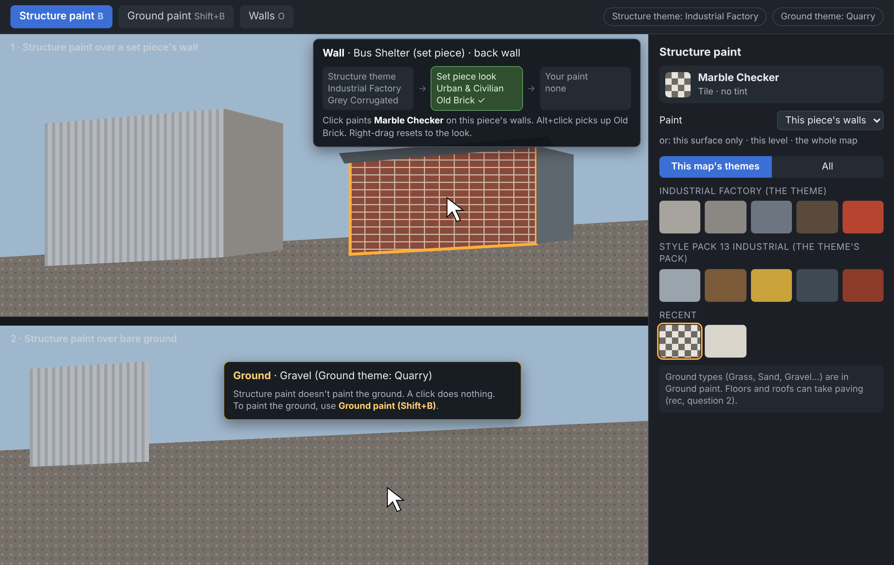
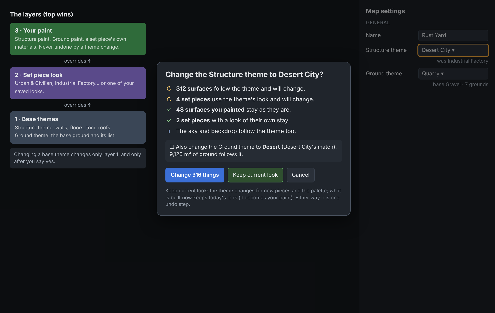

# MapMaker painting made clear: the plan

Lane B's splitters22, 2026-11-15. A plan only: no code yet. It answers the QUEUE item at the top of Bugs,
"MapMaker painting made clear", and follows the owner's direction of 2026-11-15 exactly.

| | |
|---|---|
| Status | Owner: all picks (1a–8a), 2026-11-15, and every part of a set piece designable. **Phase 1 built** ("Phase 1: as built", below), with per-part set-piece paint brought forward from Phase 5. **Phase 2 built** ("Phase 2: as built"). **Phase 3 built** ("Phase 3: as built"). **Phase 4 built** ("Phase 4: as built"; map format v45). **Phase 5 built** ("Phase 5: as built"; map format v47). |
| Pictures | `map-briefs/painting/mockup-painters.png` (the two painters, the cursor label) and `map-briefs/painting/mockup-theme-warning.png` (the layers, Map settings, the warning). Their HTML sources are beside them. |
| Map format | **v41** (Phase 1: a tile's `metal` surface and a set piece's `overrides.paint`; v40 stays free for the tunnel kit). Format change A (the Ground theme, Phase 4) is **v45** (v44 kept for the tunnel kit's set piece `family`). |
| Shipped maps | Look exactly the same after every phase. A test proves it. |

## The owner's direction, in short

1. Two painters, never mixed. **Structure paint** never touches the ground. **Ground paint** never touches a structure. Neither swaps a material silently.
2. Two base settings in Map settings: a **Structure theme** and a **Ground theme**. They are always the lowest layer. Set-piece looks sit above them. Every player edit sits above everything and is never lost when a base theme changes.
3. Set pieces are painted with Structure paint, per placement, without Explode. Players can save their own looks.
4. A warning with counts before any base-theme change, with "Keep current look". This includes the palette's "Use theme" button.
5. The palette and paint lists show the map's themes first. "All" is one click away.
6. The cursor says what it will paint and which layer the look comes from: base theme → set piece look → your paint. Every visible surface is paintable.

## Today

One Paint tool (B, `packages/client/src/editor/paintTools.ts`) paints both tiles and the ground. What it paints
depends on what the hover ray hits first (`hover.ts`, `updateHoverTarget`).

**Cause 1: Marble Checker became Gravel.** The terrain can only draw its eight ground layers
(`TERRAIN_MATERIALS` in `shared/src/map/terrain.ts`: grass, dirt, stone, sand, gravel, snow, moss, dark earth). Each cell
stores one of those eight (`TerrainData.materials`). When Paint is over bare ground, `PaintTools.groundPaint` calls
`terrainMaterialFor` (`shared/src/map/terrainPaint.ts`). For a material that is not a ground layer, it guesses the
nearest by pattern, then by colour. Marble Checker (`core.pbr_checker`) is grey, so it became Gravel. The status line
shows the guess in small type, but nothing stops the stroke.

**Cause 2: walls sometimes don't paint.** `PaintTools.paintTarget` only accepts a face whose box belongs to a grid
tile (`classicStructure.tiles`). `hover.ts` even casts the ray against tile boxes only (`this.paintable.tiles`). So:
- a free block's face is skipped;
- a set-piece part (`sp_<id>_<n>`) is skipped;
- a thin wall can be missed at its edge.

When the ray finds no tile face, `brushAtHover` (`editorInput.ts`) falls through to the ground
(`paintGround && !hoverFace`). The click paints the ground behind the wall instead.

**Cause 3: the theme changes everything at once, with no warning.** The theme can be changed in three places:
- Map settings' Theme select (`mapProperties.ts`, `ed-prop-theme`);
- the top bar's theme select (`topBar.ts`, `ed-theme`);
- the palette's "Use theme" button (`paletteBuilder.ts`, `buildPackPicker`, `ed-pack-theme`).

All three run `setThemeCommand` (`shared/src/editor/operations.ts`) straight away. Every unpainted tile surface
changes. So does every set piece without its own look, because `placementPack` (`shared/src/map/setPieces.ts`) falls
back to the role pack of the map's theme. Painted surfaces are kept and undo works, but nothing says what will change.

**Cause 4: set pieces are themed somewhere else.** A set piece's look is its role pack (`SetPiecePlacement.pack`). Its
per-piece materials are `overrides.roles`. Both are set only in the inspector (`setPieceTools.ts`, `pieceInspector`:
Look, Materials). Paint can't reach a set piece. To change one part you must Explode it. There is no way to save a
look of your own: looks are the 15 shipped role packs in `content/setpieces/roles.json`.

Also: ground painting lives in two places, Paint over bare ground and the Terrain tool's Paint brush
(`terrainTools.ts`, `terrainMaterial`).

## The layers

### The model

| Layer | Structures | Ground |
|---|---|---|
| 1. Base theme | Structure theme (`classicStructure.theme`): a material for each slot (floor, walls, pillars/cover/steps, underside, trim) | Ground theme (new): the base ground every unpainted cell shows, and the ground list the map offers first |
| 2. Set piece look | The placement's look (`pack`), else the theme's matching look | none |
| 3. Your paint | A tile's `surfaces`; a free block's `material`; a set piece's `overrides.roles` and its new per-part paint | A painted terrain cell |

The top layer that has a value wins. A theme change only ever changes layer 1. Layers 2 and 3 are never rewritten by it.
The one exception is **Keep current look**: it copies today's look into layer 3, on purpose, in one undo step.

Most of this already exists for structures:
- `resolveSurface` (`shared/src/map/surfaces.ts`) is already "tile override, else theme".
- `roleValue` (`setPieces.ts`) is already "placement override, else look, else the piece's own, else theme".

What is missing:
- the ground's base layer;
- paint on a single set-piece part;
- saved looks;
- one function that says which layer a surface's look comes from.

### New shared code (no format change)

A new file, `packages/shared/src/map/paintLayers.ts`:
- `surfaceLayer(doc, target)`. For a tile slot, a block, a set-piece part slot or a terrain cell, it returns the look and
  all three layers' values, marking the winner. The cursor label and the counts both use it.
- `themeChangeImpact(doc, { structure?, ground? })` returns:
  - how many surfaces follow the theme and will change;
  - how many set pieces use the theme's look;
  - how many you painted, which stay;
  - the ground area (m²) that follows the Ground theme.
- `keepCurrentLookCommand(doc, change)` is one batch command. It writes today's resolved look into layer 3 for
  everything that would change, then changes the theme.

A "surface" in the counts means one painted slot of one piece: a tile's walls, a block, or a set-piece part's floor.
It is not a triangle. Ground is counted in m².

### Format change A: the ground's base layer (next free version)

`TerrainData` gets two fields:
- `groundTheme`: the Ground theme's id, for example `ground.quarry`.
- `grounds`: the map's own ground list, up to 16 ground materials (`core.pbr_gravel`, `core.packed_snow`…).

`materials[i]` changes meaning:
- `0` means **the base**: the cell follows the Ground theme.
- `k` means **painted** with `grounds[k-1]`.

This removes every silent swap. Painting Packed Snow adds Packed Snow to the map's list. The terrain draws it as itself,
since `mapMeshes.ts` already builds one mesh per material (`terrainStyle`). `terrainMaterialFor` stays, but only for
how a ground **behaves**: plant cover (`cellFoliage`), and what the Environment brush grows on
(`envBrush.ts`). It never decides a ground's **look** again.

Ground themes are new content: `groundThemes` in `content/materials.json`, generated through `pnpm content:rebuild`.
Each one has:
- an id and a name;
- a base ground;
- the ground list it puts first;
- the Structure themes it suits. Each Structure theme names one as its match.

The first set is about ten, made only from the 19 shipped Ground materials: Meadow, Woodland, Rocky, Desert, Quarry,
Snowfield, Moorland, Urban (asphalt), Volcanic and Coastal. The exact list goes to the owner in Phase 4's pictures.

**Migration** (`migrate.ts`, `groundLayersV<next>`), for every map with terrain:
1. `grounds` becomes today's eight layer materials, in today's order (`TERRAIN_SURFACES`), so every index keeps its look.
2. The map's most common layer becomes the base. `groundTheme` is the shipped Ground theme whose base is that material.
   Each of the eight layers is some theme's base, so there is always one.
3. Cells of that layer become `0` (they follow the theme). Every other cell keeps its look as painted (`k`).

On shipped maps the most common layer covers 33–100 % of the ground (median 64 %). So a Ground theme change on an old
map really changes most of its ground, and the rest is kept as painted. This is question 6.

The tints carry over too. Gravel's darkening tint (`terrainStyle`) moves into the drawing of `core.pbr_gravel` as a
ground, so it looks the same.

### Format change B: set-piece paint and saved looks (next free version after A)

- `SetPiecePlacement.overrides.paint`: per part, by part index (as `overrides.hide` already is):
  - a tile part: `{ slot: SurfaceStyle }`;
  - a block part: `{ material, tint }`.

  `setPieceParts` applies it last, so it wins over the role and the look. Explode carries it onto the exploded tiles.
  Mirror and turn keep it.
- `lookDefs` on the map: the player's own looks that the map uses. Each one has a `my_<name>` id, a name, and role values
  (`SetPieceRoleValues`). This works like `setPieceDefs` for your own set pieces. The same looks also live in the
  player's browser library, next to their set pieces (`storage.ts`).

**Migration B** is a no-op. Both fields are new and optional, so old maps mean exactly what they meant.

### How we prove shipped maps look the same

- **Before Phase 4**, a script run on origin/main writes `packages/shared/test/fixtures/paintLooks.json`. For each map in
  `maps/` and `maps/templates/`, it holds one hash of every face's resolved material and tint and every terrain cell's
  material and tint. The fixture is about 100 lines, and the script stays in `tools/`.
- **A new test, `paintLooks.test.ts`**, loads every map with the new code and checks each hash. Any change to
  migration, `resolveSurface`, `setPieceParts` or terrain drawing that alters a shipped map's look fails it, and it
  names the map.
- **`groundLayersV<next>.test.ts`** checks one old fixture map cell by cell: the base cells, the painted cells and the
  tints.
- The all-maps unit test (`allMaps*`), the coverage map's flow and the `visual` baselines must stay unchanged, with no
  baseline regenerated.

## The UI

### The two painters

| | Structure paint | Ground paint |
|---|---|---|
| Key | B (as Paint today) | Shift+B (free today) |
| Tool bar | Build tab | Environment tab (Paint's place today) |
| Paints | tile slots, free blocks, set-piece parts, thin walls | terrain cells only |
| List | building materials (every category but Ground; floors and roofs may also take ground materials, question 2) | the 19 Ground materials only |
| Over the ground | does nothing; the label says "Structure paint doesn't paint the ground. Use Ground paint (Shift+B)." | paints |
| Over a structure | paints | the stroke passes under it; the building is never painted |
| Alt / I | picks up the look under the cursor | picks up the ground |
| Right-drag | resets to the layer below (look or theme) | resets cells to the base |

- The Terrain tool's Paint brush becomes Ground paint, so the ground is painted in one place. T still cycles the sculpt brushes.
- `terrainMaterialFor` is gone from the paint path.
- A material a painter can't use is not in its list. Search finds it with a note, for example "Marble Checker: Structure paint only".
- **Every visible surface is paintable.** The Structure paint ray is cast against everything drawn except invisible barriers. That includes tiles, blocks and set-piece parts. Thin boxes (under 20 cm) get a few centimetres of pick margin, so a wall's edge is caught.
- A miss never falls through to the ground.
- **Props** have their own models and are not paintable. The label says so ("Prop: its own model, not paintable"). Roads say "Road: its surface is in the path's inspector".
- **Scope** keeps today's list (`PaintScope`): this surface, all of this piece, this level, the whole map. On a set piece, "all of this piece" means the role in this placement (`overrides.roles`): all its Stone, for example. "This surface" means the one part (`overrides.paint`). Question 5 picks the default.

### The cursor label

The label is the status line (`ed-target`) plus a small card by the cursor. It shows:
- what is under the cursor: Wall · Bus Shelter (set piece) · back wall;
- the chain of three layers, with the one shown marked: Structure theme Industrial Factory: Grey Corrugated → Set piece look Urban & Civilian: Old Brick ✓ → Your paint: none;
- what a click will do: "Click paints Marble Checker on this piece's walls."

On the ground with Ground paint, it says: "Ground · Gravel (Ground theme: Quarry) · click paints Packed Snow · radius 6 m".

### Map settings

- Map settings' General group gets two rows:
  - **Structure theme**: today's Theme select, renamed;
  - **Ground theme**: new, with a line under it, "base Gravel · 7 grounds".
- The top bar's theme select (`ed-theme`) goes. In its place there are two small chips: "Structure theme: …" and "Ground theme: …". They open Map settings, so the theme is changed in one place.
- The palette's "Use theme" button stays where it is, but it goes through the same warning.

### The warning

Every base-theme change goes through one dialog: Map settings, "Use theme", and a template's theme. It says:
- "312 surfaces follow the theme and will change."
- "4 set pieces use the theme's look and will change."
- "48 surfaces you painted stay as they are. 2 set pieces with a look of their own stay."
- "The sky and backdrop follow the theme too." (Only when the map has no backdrop of its own.)
- For a Structure theme change, a tick box, off by default: "Also change the Ground theme to Desert (Desert City's match): 9,120 m² of ground follows it." (Question 4.)

It has three buttons:
- **Change** applies the change.
- **Keep current look** changes the theme but writes today's look into your paint (`keepCurrentLookCommand`). The theme then only affects new pieces and the palette.
- **Cancel** puts the select back.

Change and Keep current look are each one undo step. A change where nothing would differ skips the dialog: an empty map, say, or a theme with the same materials.

### The palette follows the map's themes

- The Style Pack picker (`ed-pack`) gets a new first choice, **This map's themes**, which is the default. It puts first:
  - the Style Packs whose `themes` include the map's Structure theme;
  - their tiles, props and set pieces (`stylePackHas`, `setPieceSuitsStylePack`);
  - the matching looks.
- **All** is the second choice, one click away. Picking one pack still narrows to that pack, as today.
- Structure paint's list: the theme's own slot materials first, then the theme's packs' `materials`, then Recent. All is behind a tab.
- Ground paint's list: the Ground theme's list first, then the other Ground materials.
- The palette follows a theme change at once.

### Saved looks

- The set-piece inspector's "Materials" section stays. It shows each role's layer ("from the look", "your paint").
- **Save as my look…** names the current role values. The look goes into your library and into the map's `lookDefs` when used.
- The Look select is grouped: This map's themes, My looks, All looks.
- A saved look is roles only, so it fits any set piece (question 7). A painted part stays with its placement. "Save as set piece…" still saves a whole piece with its paint.
- Shipped looks are not editable. "Save as my look…" makes a copy.

## Phases

Each phase is small and lands green by itself. Phases 1–3 need no format change.

**Phase 1: two painters, no silent swaps.**
- What it does:
  - Structure paint (B) and Ground paint (Shift+B), with their own lists.
  - The Terrain brush's Paint becomes Ground paint.
  - Free blocks and thin walls are paintable.
  - A miss never paints the ground.
  - Ground paint offers only the eight current layers (more come with Phase 4).
  - Plain labels: what will be painted and what a click does.
- Files: `paintTools.ts`, `hover.ts`, `editorInput.ts`, `terrainTools.ts`, `toolBarTools.ts`, `shared/src/editor/keymap.ts`, `paletteBuilder.ts` (`buildPaintPalette`), the tour.
- Unit test: `paintTargets.test.ts` (shared). Which targets each painter takes: tile, block, thin wall, set-piece part (refused until Phase 5, with a message), prop, ground.
- E2E (`editortools`):
  - Structure paint on bare ground changes nothing and shows the message;
  - Marble Checker is not in Ground paint's list;
  - a free block and a thin wall paint;
  - Ground paint under a building leaves its walls.
- E2E (`editorux`): today's "Paint from far out paints the ground" check moves to Ground paint.

**Phase 1: as built (2026-11-15, lane B's splitters22, `wip/painting-1`).**
- **The bars bug first** (owner, 2026-11-15): a Cage Block's bars drew in its walls' Stone (and `ROLE_THEME_SLOT` sent
  metal to the theme's solids), so a theme or look change made them brick. Now a tile has a **Metal** surface
  (`surfaces.metal`, format v41; `SURFACE_SLOTS`): edge styles with `"paint": "metal"` (bars, barred gate) draw
  their segments in it. Unpainted it is the theme's optional `metal` (content/materials.json, checked to
  be a Metal) else `DEFAULT_METAL` (`core.pbr_steel`). `ROLE_THEME_SLOT.metal` is `metal`, and a metal role no look
  gives resolves to that metal in expansion too. The owner's answers (2026-11-15, "1a 2a 3a"): **the Cage Block's
  bars are iron in every look** (no metal role on its pens: the theme's metal, which no theme names, so
  `core.pbr_steel`, as a tile's own bars on Sandfall); **railings stay in the walls' surface** (no `paint` on
  `railing`: they look as before); **the tall fence is as it was**. `metalBars.test.ts`: every bar and gate face,
  across every theme and every look, is a Metal, the Cage Block's are `core.pbr_steel` in every look, and a railing
  is the walls' surface. The tile inspector shows a Metal row only on tiles with bars. Shipped maps that change, all
  on purpose: the 8 whose own tiles have bars or a barred gate (cinder_foundry, hollowmere_manor, iron_tide,
  ironhold_prison, norman_shores, obsidian_orb, pump_tower, sandfall_colosseum: bars were the theme's walls, now
  iron), blackout, crossroads and iron_maw (a Loading Dock's metal blocks on a theme with no look: were the theme's
  solids, now iron), and the coverage map. No map file changed.
- **Structure paint (B)** (`paintTools.ts`, shared `editor/paintTargets.ts`): the Paint tool, on the Build and
  Environment bars. It casts at everything drawn but the invisible walls (`hover.ts`); boxes thinner than 20 cm are
  caught 4 cm outside their faces. It paints a tile's slot, a free block (scopes as for tiles: same type = the same
  material), a set-piece part, and bars (the Metal slot). Over bare ground it does nothing and the status line and a
  toast say "Structure paint doesn't paint the ground. Use Ground paint (Shift+B)."; a prop says "Prop: its own model,
  not paintable", glass that it stays glass. A miss never paints the ground; `terrainMaterialFor` is gone from the
  paint path. The status line says what is under the cursor, its look now, and what a click paints where (the
  three-layer chain is Phase 2).
- **2a**: a Ground material goes on a tile's floor and roof (and a block: slabs and ramps, as the Parking Deck Ramp's
  asphalt), never on walls, trim, pillars, the underside or metal: refused with the reason, left out of the tile
  inspector's lists for those slots and of the set-piece roles but floor, paving and roof. Structure paint's list
  heads the ground materials "Ground (floors and roofs only)".
- **Ground paint (Shift+B)**: the Terrain tool's Paint brush, named Ground paint (its button on the Terrain tab, a
  Ground button on the Environment bar, the line under the bar). Its list is the eight ground layers (Phase 4 brings
  the rest). It never touched buildings; it passes under them. T cycles the sculpt brushes only.
- **Set pieces, every part (owner's 5a and extra ask), brought forward from Phase 5's format change B:** a new
  "On a set piece" choice in the Paint tab, **Across the piece** (default) or **This surface only**. Across the piece
  sets the role in this placement (`overrides.roles`: all its Paving, say) and clears part paint it reaches; a slot or
  block with no role paints every part given the same way. This surface only writes `overrides.paint` (by part index,
  as `hide`): a tile part's surfaces, a block part's material. Expansion applies it last, so it wins over the role and
  the look; it lasts through a theme change, mirror, turn, Explode and the file; paint on a part without that surface
  is a validator warning. Props, doors, ladders and lights have no paintable surface. Saved looks and `lookDefs`
  stay in Phase 5.
- **Undo**: every click or drag is one step (tiles, blocks, set pieces, the ground stroke).
- Tests: `paintTargets.test.ts` (targets, refusals, the 2a rule, commands, set-piece paint lasting),
  `metalBars.test.ts`, keymap. E2E: `editortools` (`editorPaintChecks`: the ground refused, a block, a 10 cm wall at its
  edge, bars, gravel refused on a wall and taken by a floor, undo, Shift+B's list and a stroke under a room),
  `editorpieces` (`editorPiecePaintChecks`: across the piece, one pen's bars, a theme change, undo), `editorux` (far-out
  Ground paint, the tool bars).
- The owner's three calls on it are answered (1a 2a 3a, above).

**Phase 2: the layers on the cursor, and the warning.**
- What it does:
  - `paintLayers.ts` (`surfaceLayer`, `themeChangeImpact`, `keepCurrentLookCommand`);
  - the cursor's chain;
  - Theme renamed Structure theme;
  - the top bar select replaced by chips;
  - the warning on Map settings and on "Use theme".
- Unit test: `paintLayers.test.ts`.
  - Counts on the coverage map (`maps/test_coverage.json`).
  - Keep current look leaves every resolved face the same (hash) while the theme id changes.
  - A painted surface survives every theme.
- E2E (`editortools`):
  - the dialog's counts match `themeChangeImpact`;
  - Cancel changes nothing;
  - Change and Keep current look are one undo step each;
  - "Use theme" opens the same dialog.
- Flicker: a dialog, not a bright moment, so nothing new for `flashing`.

**Phase 2: as built (2026-11-15, lane B's splitters22, `wip/painting-2`).** No map format change.
- **Shared** (`packages/shared/src/editor/paintLayers.ts`, in `editor/` rather than `map/`): `themeChangeImpact(doc,
  library, to, boxes?)`, `keepCurrentLookCommand(doc, library, to, boxes?)`, `surfaceLayer(doc, library, target,
  faceSlot?)`, `groundLayerAt(terrain, x, z)` / `baseGround`, `drawnSlots`. A "surface" is one slot a piece draws,
  read from its boxes (`buildMapGeometry` + `buildMapDecor`): a room's floor, underside, walls, trim…; a block is one.
  - **Counts.** Surfaces that follow the theme and will change: the map's own tile slots nothing paints, unpainted
    blocks, and a set piece's part slots nothing above the theme gives (an underside a look leaves to the theme).
    Set pieces that will change: those on the theme's look whose look changes. Painted surfaces: tile slots, painted
    blocks, a set piece's painted roles and part paint. Set pieces with a look of their own (`pack`). The sky line when
    the map has no backdrop of its own. A change where none of it changes skips the dialog (the toast says so).
  - **Keep current look** pins exactly today's resolved look: tile slots in `surfaces` (the floor before the roof,
    which follows it), unpainted blocks a `material`, set pieces their look's roles in `overrides.roles` (facade, door
    and glass too: an absent one pinned as none, sliding, none) and any part still following the theme in
    `overrides.paint`; then `setTheme`, all one batch (one undo step). **One exception, for the owner:** an unpainted
    block shows the theme's floor on top and its underside on the sides, and a block holds one material, so a block
    whose two differ keeps the one it shows most (by area: a slab its top, a wall its sides); the dialog says how many.
    Exact would need per-face block paint (a format change, e.g. with Phase 5's).
  - `paintLayers.test.ts`: the counts on a scene and on the coverage map match a real change face by face; Keep
    leaves every drawn surface (and facade, glass, door) the same on the scene and on the coverage map into four
    themes and from a look to another, nothing left to change going back, one undo step; paint survives every theme;
    the chain for a wall, a painted wall, a set piece (theme's look, own look, painted across), a block; the ground.
- **The warning** (`client/src/editor/themeChangeDialog.ts`, `changeStructureTheme`): every theme path goes through
  it: Map settings' theme (renamed **Structure theme**), the top bar's `ed-theme` (kept: the chips wait for Phase 3,
  which regenerates the `mapmaker.png` baseline anyway) and the palette's "Use theme". Counts, "Change N things",
  "Keep current look", Cancel (and Esc); the select goes back on Cancel. The Ground theme tick box is left out until
  the Ground theme exists (Phase 4). No `setThemeCommand` caller is left outside the dialog. A dialog: nothing flashes.
- **The cursor** (`paintTools.ts` `describe`/`card`, `hover.ts`): Structure paint's card by the cursor names the
  surface (Wall, Floor, Trim, Roof, Metal, Block) and what it is on, shows Structure theme → Set piece look → Your
  paint as three chips with the shown one marked ✓ (the look's source says "(the theme's)" or is the piece's own),
  then what a click does, Alt+click and right-click. The status line says the same in words. Over bare ground: "Ground
  · Gravel (the map's main ground)" and that a click does nothing. Ground paint's card and status name the ground layer
  and whether it is the map's main ground (its most common layer, MapMaker's existing "main ground") or painted.
- E2E (`editortools`, `editorThemeWarningChecks`): each path opens the dialog with `themeChangeImpact`'s counts;
  Cancel and Esc change nothing; Change and Keep are one undo step each, Keep leaving nothing to change back; the card's
  chain (look shown, then your paint after a click), the ground card, Ground paint's label. `editorux`'s layout checks
  click Change in the dialog. Screenshots at device scale 2 with `E2E_SHOTS` (`editortools-paint2-*.png`).

**Phase 3: the palette follows the themes.**
- What it does: the "This map's themes" default, All one click away, theme-first paint lists.
- Unit test: `palette.test.ts` (client) gains the ordering.
- E2E (`editorux`): the default shows the theme's packs first, and All shows everything. The `mapmaker.png` baseline is regenerated (`pnpm e2e:baselines`).

**Phase 3: as built (2026-11-16, a helper of lane B's splitters22, `wip/painting-3`).** No map format change.
- **The palette** (`paletteBuilder.ts` `filterPalette`, `palette.ts` `order`/`mark`, pure rules in `paletteCatalog.ts`):
  the Style Pack picker's first choice is **This map's themes**, the default (not remembered between sessions). The
  packs that use the map's Structure theme (`themeStylePacks`: the pack whose own theme it is first, then those that
  list it) have their tiles, props, set pieces (by the looks they suit) and gameplay pieces put first in each group,
  and in a prop group within each category, each part in the catalogue's order (`themeRank`, `rankedOrder`); they
  carry a small steady dot in the tab's colour. **Nothing is hidden**: everything else follows, so search, the
  Set pieces tab's full list and every tool still reach every piece. A note under the picker names the packs; a theme
  no pack uses (Prototype, the new map's, and Lab, Station, Neon, Volcano) says so and keeps the catalogue's order.
  **All pieces** (the second choice, value `''` as before) is the catalogue's order, unmarked; a pack still narrows to
  its own pieces and offers "Use theme" through the warning. It follows a theme change at once (`syncTheme`, from the
  top bar's refresh), undo included.
- **Structure paint's list**: a **This map's themes | All** switch over Materials. This map's themes lists the
  Structure theme's own slot materials (floor, walls, solids, underside, trim, then its metal or `DEFAULT_METAL`),
  then the materials of its packs, then Recent (materials picked lately, at most 8), none twice
  (`themePaintList`); All is every material by kind, as before. Same buttons in both (moved, the rest hidden), so the
  lit material, search and favourites are the same. Recent is rebuilt as the tab opens or the view changes, never
  under the pointer.
- **Ground paint's list**: until the Ground theme (Phase 4), "This map's grounds" are the ground layers the terrain
  has, most cells first (the main ground leads), then any whose surface the theme's packs list; then "Other grounds"
  (`themeGroundOrder`). Phase 4 replaces the lead with the Ground theme's list.
- **The top bar**: the `ed-theme` select is gone; a **Structure theme** chip names the theme and opens Map settings at
  its Structure theme select (focused), so every change goes through Phase 2's warning (`changeStructureTheme`). The
  Ground theme chip comes with the Ground theme (Phase 4). Under 1400 px the chip shows the name only; it goes at
  `fit-6` as the select did.
- Tests: `palette.test.ts` (the packs for a theme, own first; theme-first order stable within each part, All the
  catalogue's; Structure paint's three sections; Ground paint's order). E2E `editorux` `editorThemeViewChecks`
  (Prototype keeps the catalogue's order; Military's pieces first and marked, nothing hidden; All unmarked in order;
  Structure paint's sections, All, Recent; Ground paint's headings) with screenshots `editorux-themes-*.png`;
  `editorLayoutChecks` and `editortools`' theme warning use the chip; `editor` picks its materials under All.
  Baseline regenerated: `mapmaker.png` (the chip in place of the select) only.
- Nothing flashes: a steady dot and reordered cards.

**Phase 4: the Ground theme (format change A).**
- What it does:
  - `groundThemes` content;
  - `terrain.groundTheme` and `terrain.grounds`;
  - `materials` 0 = base;
  - the migration;
  - `mapMeshes.ts`, `foliage.ts`, `envBrush.ts`, `backdrop.ts` (the ground past the border), `mirror.ts`, `heightGrid.ts` and `frontend/mapPlan.ts` read the new encoding;
  - Map settings' Ground theme row and its warning;
  - Ground paint offers all 19 grounds with no substitution;
  - a new terrain starts as the base.
- Tests:
  - `groundLayersV<next>.test.ts` and `paintLooks.test.ts` (with the fixture written first, on origin/main);
  - the all-maps test unchanged;
  - `editorenv` e2e: Ground theme change with counts, painted cells stay, Packed Snow paints as Packed Snow;
  - `visual` baselines unchanged.
- Pictures of the ten Ground themes go to the owner before this phase lands.

**Phase 4: as built (2026-11-16, a helper of lane B's splitters22, `wip/painting-4`).** Map format **v45**.
- **Content.** `groundThemes` in `content/materials.json` (checked and generated by `tools/content/materials.mjs` into
  `GROUND_THEMES`, shared `groundThemes`): ten, each a base, the grounds offered first (base first) and the Structure
  themes it suits. Meadow (Grass), Woodland (Forest Floor), Rocky (Mossy Rock), Desert (Desert Sand), Quarry (Gravel),
  Snowfield (Snowy Ground), Moorland (Moss), Urban (Asphalt), Volcanic (Wet Asphalt, with Lava listed) and Coastal
  (Shingle). Every Structure theme names its match (`ground`, checked to be listed in that Ground theme's `suits`).
  **Ground materials** are the 19 of the Ground category plus the two old layers that are not in it, Mossy Rock (the old
  "Stone") and Hex Paving (the old "Dark earth"), which shipped maps use: 21 in all (`GROUND_MATERIALS`). Nothing else
  can be ground (the generator, `isGroundMaterial`, the validator).
- **Format** (shared `map/terrain.ts`, `map/schema.ts`): `terrain.groundTheme` (absent: Meadow) and `terrain.grounds`
  (at most 16); a cell is 0 (the base) or k (`grounds[k − 1]`). `cellGround`, `cellPainted`, `groundStyle` (the material
  and its ground tint: Gravel's `#8f877b` moved here from `mapMeshes.ts`), `groundKind` / `cellKind` (what a ground
  behaves as: `terrainMaterialFor`, moved into terrain.ts, now only for plants, the Environment brush's filters, the
  border's ground kind and a height-grid import's plants), `groundIndex` (adds a ground to the list; a full list first
  drops grounds no cell uses; null when 16 are in use: Ground paint says so and never substitutes), `newTerrain(…,
  groundTheme)` (all base), `applyBrush`'s `ground` (null: back to the base), `paintSlopes` (Mossy Rock, painted).
- **Migration** `groundLayersV45` (`migrate.ts`; v43 -> v44 an identity step kept for the tunnel kit): `grounds` = the
  eight old layers in order (old j is k = j + 1); the base is the most common layer **that is some Ground theme's base**
  (the first such theme; ties to the earlier layer), its cells 0; every other cell painted. Hex Paving is no theme's
  base, so a map mostly Hex Paving takes the next layer as its base (all Hex Paving: Meadow, every cell painted); no
  shipped map is. Shipped maps' bases (52 with terrain): Meadow 29, Desert 10, Rocky 6, Snowfield 3, Moorland 2, Quarry
  1, Woodland 1.
- **The proof.** `tools/maps/paint-looks.ts` wrote `packages/shared/test/fixtures/paintLooks.json` on origin/main
  first (its own commit): per map in `maps/` and `maps/templates/`, loaded as played, a hash of every box's resolved
  style on its top and sides, and one of every terrain cell's drawn material and tint, plant cover and ground kind plus
  the ground past the border. `paintLooks.test.ts` checks all 94 against it with the new code: **all the same**.
  `groundLayersV45.test.ts`: Backwoods (v36, six layers) cell by cell (base cells, painted cells, Gravel's tint, plants),
  the tie and Hex Paving rules, a Ground theme change, Keep, Packed Snow as itself, the full list.
- **Readers.** `mapMeshes.ts` sorts cells by ground (the old layers keep their mesh names, `…_terrain_grass`, and the
  soft borders' order; any other ground's mesh is named by its material, `…_terrain_core.packed_snow`); `foliage.ts`
  and `envBrush.ts` read `cellKind`; `backdrop.ts` (shared `backdropGroundSurface`: the commonest edge ground itself
  past the border, Packed Snow as Packed Snow; `resolveBackdrop`'s `ground` its kind); `paths.ts` lays a path's ground
  as a painted ground; `changeGrid.ts` resamples up to 17 values; `mirror.ts` copies cell values (the same list);
  `heightGrid.ts` (unreached cells the base, the current terrain's theme and list kept); `frontend/mapPlan.ts` (the old
  layers' plan colours, any other ground its material's colour).
- **MapMaker.** Map settings' General: **Ground theme** under Structure theme (grouped "Suits <theme>" / "Other",
  "base Gravel · 7 grounds" under it), through its own warning (`themeChangeDialog.ts` `changeGroundTheme`: m² that
  follow and will change from one base to the other, m² painted that stay, the border line; Change, Keep current look,
  Cancel; one undo step each; a change that looks no different skips it). The Structure theme warning gets Phase 2's
  left-out tick box, off: "Also change the Ground theme to Desert (Desert City's match): N m² of ground follows it"
  (with Keep, the ground keeps its look too). A **Ground theme chip** beside the Structure one (`ed-ground-chip`, opens
  Map settings at the row; "No terrain" without one). The Terrain tab's "Main ground" swap went: it shows the Ground
  theme with a Change… button to the same place. **Ground paint** offers the Base chip (back to following the theme;
  Shift+drag does the same with any ground) and all 21 grounds, each drawn as itself, under "Ground theme: <name>" (its
  list, then grounds the map painted) and "Other grounds" (`paletteCatalog.ts` `themeGroundOrder`). The card and status
  line say "Gravel (Ground theme: Quarry)" or "Sand (painted; Ground theme Quarry: Gravel)". A new terrain (Terrain
  tab, New map) picks a Ground theme (default: the Structure theme's match; New map: Meadow) and starts all base.
- Tests: the two above, `terrain.test.ts`, `paintLayers.test.ts` (the ground under the cursor), `palette.test.ts`
  (Ground paint's order), `backdrop.test.ts`, `terrainGrid.test.ts`, `materialsData.test.ts` (the fixture minus the new
  `ground` field). E2E `editorenv` `editorGroundThemeChecks` (a new terrain all Meadow, the chip; Packed Snow paints as
  itself, its own mesh; the warning's m² match; Cancel; Change moves only base cells, Packed Snow stays, one undo;
  Keep keeps every cell; the Structure warning's tick box changes both in one step), screenshots `editorux-ground-*.png`
  with `E2E_SHOTS`; `editortools` and `editorux` ground lists and labels updated. Baselines: only `mapmaker.png` (the
  chip). Nothing flashes: a dialog and a chip.

**Phase 5: set pieces with Structure paint, and saved looks (format change B).**
- What it does:
  - `overrides.paint` and its expansion;
  - painting parts with both scopes;
  - the look layer in the chain;
  - Save as my look, `lookDefs`, the grouped Look select.
- Unit test: `setPiecePaint.test.ts`.
  - Paint applies.
  - It wins over the look.
  - It survives a theme change, mirror, turn and copy-paste.
  - Explode keeps it.
  - A saved look round-trips through the map file.
- E2E (`editorpieces`):
  - paint a Bus Shelter wall without Explode;
  - change the theme, and the paint stays;
  - save a look and put it on a second piece.
- The coverage map gets one painted set-piece part and one saved look, placed in MapMaker, so its unit test covers them.

**Phase 5: as built (2026-11-17, a helper of lane B's splitters22, `wip/painting-5`).** Map format **v47**. Per-part
paint, both scopes and the look layer in the chain were built in Phases 1 and 2; this phase adds looks of your own.
- **Format** (shared `map/schema.ts`): `MapDocument.lookDefs` (at most 32), each `{ id: my_<name>, displayName, roles }`
  (`SetPieceLookDef`; the roles are `SetPieceRoleValues`); a placement wears one through its `pack`, as a shipped role
  pack. Migration v46 -> v47 is an identity step (`migrate.ts` [46]). `withMapLooks` (map/setPieces.ts) adds the map's
  looks to the role packs wherever a map is expanded (never replacing a shipped pack, never a theme's default); as
  played the looks are in the parts and the map carries none. The validator: a look's id twice or a shipped id is an
  error; a material the game hasn't got, or a ground material off floor, paving and roof (2a), a warning.
- **Commands** (shared `editor/myLooks.ts`, command `setLookDefs`): `saveLookCommand` (the look as it shows:
  `placementLookRoles`, each role from your paint across the piece, else the look, else the piece's own; a role none
  gives is **left out**, so it keeps following the theme and the piece looks exactly the same; the piece then wears it,
  its paint across the piece folded in, paint on single parts kept), `applyLookCommand` (a shipped look, one of yours,
  or the theme's; your paint stays on top; the look goes into the map, its library copy replacing the map's; looks
  nobody wears leave), `renameLookCommand`, `lookIdFor`. Deleting and Explode drop looks nobody wears
  (`unusedLooksCommand`). Copy and paste carry the looks the copied pieces wear (`lookDefs` in the clipboard); a paste
  into a map with a different look of the same id is refused, as for set pieces. Each is one undo step.
- **MapMaker** (`setPieceTools.ts`, `storage.ts` `cs.looks`, `index.html` `ed-look-dialog`): the Look select is grouped
  **This map's themes** / **My looks** / **All looks** (made-for-it ones first, marked), in the inspector and the
  placing panel; **Save as my look…** under Look (name, the look's colour chips; on a piece wearing one of your looks,
  an **Update** tick: every piece wearing it changes); **My looks** in the Set pieces tab (chips, how many pieces here
  wear it, **Apply to selected** / **Place in it**, **Rename…**, **Delete**, **Save to my looks** for a map's own);
  several set pieces selected get one Look row (`ed-insp-pieces-look`); Materials rows show their layer (your paint is
  marked). Placing in one of your looks puts it in the map.
- **Choices made here (the plan's recommendations where it had one):** a look holds roles only (7a); Update is offered
  but off by default; a role no layer gives is left out of a saved look (exact, no swap) rather than pinned to today's
  theme material; applying a look keeps the piece's paint across it; a look's library is this browser (no file
  Export/Import of looks: a map carries the looks it uses); a clashing look on paste is refused.
- **Tests:** `setPiecePaint.test.ts` (paint through copy and paste; save shows the same, one undo step; a role no layer
  gives left out; on another piece and through a theme change; library to map and back to the theme; update; rename;
  the map file and play; delete and Explode; paste; the format, validator and migration), `coverageMap.test.ts` (a
  painted part and a look two pieces wear), `setPiecePartIndex.test.ts` (the Risks' part-index lock: every part a map in
  maps/ hides or paints by index, pinned), `paintLooks.test.ts` (shipped maps the same; the coverage map's hash
  updated). E2E `editorpieces` `editorMyLooksChecks` (save, nothing changes on screen, library, My looks, Apply, the
  grouped select, rename, theme change, several pieces, a second map from the library, delete, the map dropping an
  unworn look); screenshots `editorpieces-looks-*.png` at device scale 2 with `E2E_SHOTS`.
- **Coverage map** (through MapMaker, Import / Structure paint / inspector / Export): one Cage Block pen's bars gold
  (This surface only), the Bus Shelter's look (its metal rusted plate) saved as **Coverage rust**, worn by the Porch too.
- Shipped maps: no file changed, every look hash the same. Nothing flashes: a dialog, a list and colour chips.

**After each phase:** docs/BUILDING_KIT.md, HANDOFF and CHANGELOG (Unreleased). Run `pnpm typecheck`, `pnpm test:changed`
and `pnpm e2e:changed`, then a check branch.

## Questions for the owner

1. **Two tools or one?**
   a. Two tools, Structure paint (B) and Ground paint (Shift+B), each with its own list. (rec)
   b. One Paint tool with a Structures / Ground switch that filters the list and the target.

2. **Which materials may cross over?**
   a. Floors and roofs may take ground materials (a gravel yard floor, Parking Bays on a deck). Walls and trim never do. The ground takes ground materials only. (rec)
   b. Strict both ways: structures never take ground materials.
   c. As (a), and the ground may also take paving (setts, flagstones, cobbles).

3. **What is a Ground theme?**
   a. A base ground and the list of grounds offered first. (rec)
   b. That, plus automatic rules (rock on steep slopes, sand at the water's edge) as part of the base. This would be a later phase.

4. **Do the two themes move together?**
   a. Separate. A Structure theme change offers its matching Ground theme as a tick box in the warning, off by default. (rec)
   b. Separate, with no offer.
   c. Linked: changing one always changes both.

5. **Painting a set piece: what does a click paint by default?**
   a. The material across this piece: all its Stone, for example. "This surface only" is in the scope list. (rec)
   b. Only the part clicked.

6. **The ground of maps already made: what follows the new Ground theme?**
   a. Each map's most common ground becomes its base and follows the theme. The rest counts as your paint. (rec)
   b. Everything counts as painted, so a Ground theme change does nothing on today's maps until they are repainted.

7. **What does a saved look hold?**
   a. The materials per role (stone, trim, floor…) and the facade, door and glass, so it fits any set piece. It lives in your browser and in each map that uses it. (rec)
   b. As (a), plus the per-part paint of the piece it was saved from, so it only fits that set piece.

8. **What comes first, this or Flavius Rule's octagon phase 4?**
   a. Both at once: phase 4 is map work and touches no editor code, so painting Phase 1 starts as soon as you answer. (rec)
   b. Octagon phase 4 first, then painting.
   c. Painting first, and the octagon waits.

## Risks

- **Part indices.** Per-part paint is keyed by part index, as `overrides.hide` is. If a shipped set piece's parts are reordered, the paint moves to another part.
  - Mitigation: a content test fails when a shipped piece's parts change while a map in `maps/` paints or hides them by index.
  - Stable part keys are the UI spec's Phase 4b, and stay parked.
- **The ground list's limit.** A map can use 16 grounds. At the limit, Ground paint says so and offers to swap one. It never substitutes.
- **Terrain readers.** Several files read `terrain.materials`: drawing, plants, the Environment brush, the backdrop's ground past the border, the plan picture, height-grid import and Mirror. Phase 4 must change all of them together. A grep list goes in its PR, and the all-maps test and `paintLooks.test.ts` catch any it misses.
- **File size.** The ground migration rewrites every terrain array, so map files change when next saved in MapMaker. Base cells become `0`, so the files get a little smaller.
- **Keep current look on a big map** writes many tile overrides, one per surface that follows the theme. That is one undo step, and there is no budget for overrides today. Watch the map file's size on St. John's.
- **Old clients.** A map saved at the new version won't open on an older game build. This is the usual format rule.
- **Lane overlap.** `wip/mapmaker-followups-1115` (Mirror, `facesUpdate`) also touches the editor. Painting Phase 1 rebases onto it.

## Out of scope

- Painting props (their own models), roads (the path inspector), doors' and windows' styles (the Walls tool and roles), and facades (the tile inspector).
- Painting single faces of a block: a block is one material.
- Making new materials, or importing textures. No player uploads, and no AI generation (CLAUDE.md).
- Automatic ground rules (slopes, water's edge), unless the owner picks 3b. Even then, it is a later phase.
- Repainting any shipped map. Shipped maps change only through MapMaker, by the owner's choice.
