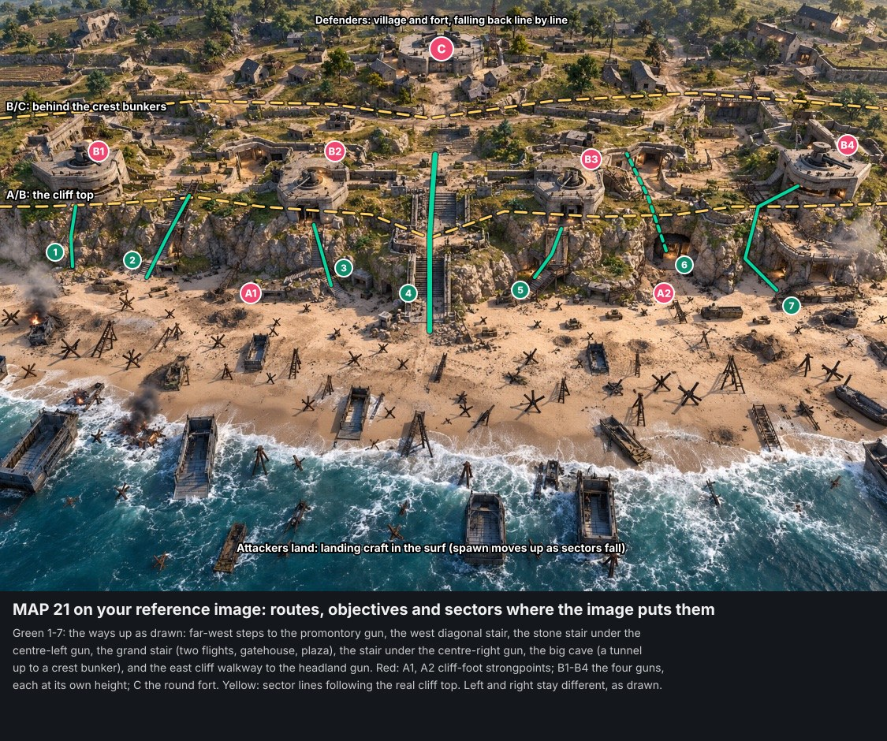

# Iron Coast (MAP 21): layout and Breakthrough mode (owner-approved, 2026-11-07)

**Status: approved by the owner on 2026-11-07:** "Yes follow the image, call it Iron Coast. This map should be a
showcase of a small 'breakthrough' or assault mode."
- The map is **Iron Coast**, id `iron_coast`.
- It follows the reference image, including cliff-foot defences instead of a long sea wall.
- It is the showcase for the new **Breakthrough** mode (below).
- **It's a large map** (owner, 2026-11-07: "Iron Coast should be (24-32) v (24-32) and higher for dedicated servers, it's
  a large map"; "small" meant nothing about its size).
It follows `MAP_21_Omaha_Beach_Assault.md` (the brief) and the owner's reference image `shingle_point_reference.jpg`.
The owner decided on 2026-11-05 that this is a new map; Shingle Point stays as its own map.

**The plan is the reference image itself.** Routes, objectives and sectors are marked where the image draws them. An
earlier schematic straightened the cliff into even bands and mirrored the two halves. The owner, rightly: "doesn't that
look a little symmetrical and not really what the ref image is?" It's gone.

## What the image has, and keeps
The map is **not mirrored**. Its two halves differ as drawn:
- **The west:**
  - a rocky promontory carries the lowest gun (B1), with far-west steps up to it;
  - a long diagonal wooden stair climbs the cliff face;
  - a pillbox and sandbag positions stand at the cliff foot (A1);
  - behind the crest there are farm terraces and scattered houses.
- **The centre:**
  - the grand stair climbs in two flights through a gatehouse to a walled plaza;
  - a lane runs from the plaza to the round fort (C);
  - the centre-left gun (B2) stands over a stone stair, and the centre-right gun (B3) over a wooden stair. The two are
    at different heights and set back differently.
- **The east:**
  - the big lit cave at the cliff foot (A2) leads into a tunnel up to a crest bunker;
  - a walkway with a railing runs along the cliff face to the highest point, the headland, which carries the biggest
    gun (B4);
  - more cave bunkers sit in the face;
  - behind the crest the village is denser.
- **The cliff line is irregular:** headlands and recesses, lowest at the grand stair's gatehouse and highest at the
  east headland (about 10–16 m).
- **Behind the crest:** a maze of walls, trenches, ruined buildings and lit bunkers at angles, on several terraces, not
  one straight line.
- **On the beach:**
  - landing craft in the surf and on the sand;
  - rows of hedgehogs and Belgian gates, irregular rather than in a grid;
  - craters;
  - two burning wrecks, with smoke and no flashing.
- **No continuous sea wall:** the image draws walls, pillboxes and sandbags at the cliff foot instead. The map follows
  the image, which comes first under AGENT_BUILD_CONTRACT.md. The brief's "sea wall" becomes those cliff-foot
  defences.

## Footprint (from the image's proportions)
- **Scale:** the landing craft (about 11 m long) give the image's own scale: roughly 300 m along the beach and 260 m from
  the surf to the fort. For 24–32 a side, build it **up to about 380 m along the beach and 320 m deep**, keeping the
  image's proportions. That is inside the 400 m terrain limit.
- **Terrain:** up to 153 × 129 vertices at 2.5 m.
- **Bands:**
  - surf and shallows;
  - about 60–70 m of beach;
  - the cliff;
  - a crest zone of about 80 m on several terraces;
  - the village and the fort.
- **Grid:** the standard 8 m cells and 4 m levels. Set pieces sit where the image puts each structure, turned to fit;
  the cliff is terrain, sculpted to the image's outline.
- **Players:** **24 v 24 to 32 v 32** (Match Setup's "Map's pick": `teamSetup [24, 24]`; 32 v 32 in the browser once
  performance round 4 raises the cap), **and more on dedicated hosts**: 48 v 48, and 64 v 64 if round 4 makes that
  possible. Smaller games still work, but this is a large map.

## Seven ways up the cliff, as drawn (green 1–7)
1. **Far-west steps** up the rock to the promontory gun (B1).
2. **The west diagonal wooden stair** across the cliff face.
3. **The stone stair** under the centre-left gun (B2).
4. **The grand stair:** two flights, the gatehouse, the plaza. The widest and the most watched.
5. **The wooden stair** under the centre-right gun (B3).
6. **The big cave:** a tunnel up into a crest bunker. Close quarters.
7. **The east cliff walkway and stair** to the headland gun (B4). Long and exposed.

The beach gives cover from hedgehogs, craters, wrecks and the landing craft. The crest's sightlines are long but broken
by its terraces and walls.

| In the image | Built from |
|---|---|
| Landing craft | `setpiece.landing_craft_beached`, `prop.lcvp_beached` |
| Hedgehogs, gates, ramps, wrecks | `prop.hedgehog_beach`, kit gates and wrecks |
| Round gun casemates (B1–B4), each placed and turned as drawn | `setpiece.casemate` |
| Cave mouths and cliff bunkers | `setpiece.casemate_cave`, with `setpiece.stair_tower_4` for the tunnel's climb |
| Grand stair, gatehouse and plaza | `setpiece.cliff_stair_grand`, kit walls; **a gatehouse piece** if the kit's arch doesn't read right |
| Diagonal wooden stairs, the walkway | `setpiece.cliff_stair_side`, kit stairs and railings |
| Trenches and walls behind the crest | trench pieces (timber and sandbag), kit walls |
| Round fort | **the command bunker set piece, not built yet** |

## Breakthrough mode (new, asymmetric)
No current mode does this. Bomb, CTF, KOTH, Hostage, Elimination and Forts are all symmetric or single-objective. It
plugs in as a new mode, `core.breakthrough` (shown as **Breakthrough**), that any map can use with sector markers in
MapMaker. Iron Coast is its showcase: three sectors, built for 24–32 a side.

**How it plays:**
- **Attackers push; defenders hold three lines in turn.**
  - **Sector A, the beach:** take the two capture zones at the cliff foot (A1, A2). Standing in a zone captures it, as
    a King of the Hill zone, contested when a defender is in it.
  - **Sector B, the crest guns:** destroy two of the four gun casemates (B1–B4). Plant a charge; defenders can defuse
    it, as in Bomb mode.
  - **Sector C, the village:** capture and hold the command bunker (C).
- **When a sector falls:**
  - the attackers' spawn moves up: landing craft → cliff foot → crest;
  - the defenders' spawn falls back: crest → fields → village;
  - defenders left behind the new line have 10 s to fall back.
- **Reinforcements:** the attackers have a limited pool (e.g. 6 per attacker at the start, plus more for each sector
  taken). The defenders have unlimited respawns, on a longer respawn timer.
- **Time:** each sector has a timer, and taking one adds time.
- **Winning:** the attackers win by taking sector C. The defenders win when the attackers run out of reinforcements
  or time.
- **Swap sides:** a second round with the sides swapped, scored by how far and how fast each side got.

**Bots** (Bot AI Phase B): a Breakthrough playbook.
- Attackers bound up the beach from cover to cover and spread over the seven routes, as numbered above.
- They use smoke (from the weapons intake) to cross open sand, and push the tunnels in groups.
- Defenders man the casemates and trenches. Snipers take the crest, and some fall back early to the next line.

**Other modes on the map:** Team Deathmatch (the whole map) and co-op (players assault bot defenders), as the brief
suggests.

## Build order (after approval)
1. **Before the map:**
   - Bot AI Phase B (running) and the MapMaker ground fix (running).
   - The **Breakthrough mode**: sim, HUD, MapMaker's sector and objective markers, and the bot playbook, tested on a
     small test layout first.
   - The missing pieces: the **command bunker** (round fort) and, if needed, a **gatehouse** for the grand stair. The
     cliff-foot defences replace the brief's sea wall.
2. **The map, in MapMaker only** (CLAUDE.md, "Maps"), per the contract's order:
   1. footprint and terrain (beach, cliff, draw, crest, fields, village rise);
   2. set pieces;
   3. trenches and walls;
   4. the village;
   5. routes checked by walking them;
   6. navigation and bots;
   7. objectives and spawns per sector;
   8. pickups (with the weapon sets: Military);
   9. the visual pass: golden hour like the reference, the Military Compound and coastal packs.
3. **Checks:**
   - the contract's acceptance tests;
   - bots take every sector in a scorecard run;
   - performance at 24 v 24 and 32 v 32;
   - overhead and eye-level screenshots against the reference.

## Owner's answers (2026-11-07)
1. **Layout:** follow the image (this page).
2. **Mode:** a Breakthrough / assault mode, with this map as its showcase.
3. **Name:** Iron Coast.
4. **Cliff foot:** walls and pillboxes as in the image, not a long sea wall.
5. **Size:** a large map, 24–32 a side, more on dedicated servers ("small" was only about the mode, and doesn't apply).
