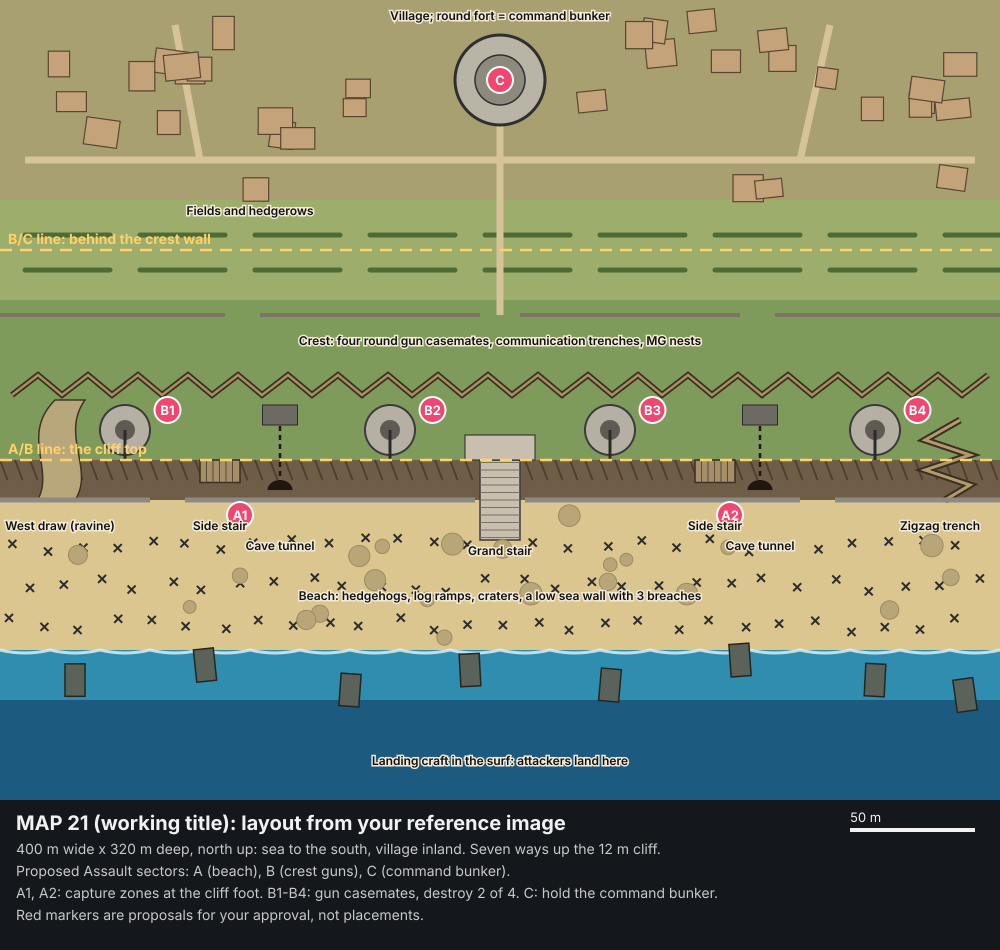

# MAP 21: layout and Assault mode (proposal for the owner, 2026-11-07)

**Status: a proposal, waiting for the owner's approval. No placement work until it's approved** (AGENT_BUILD_CONTRACT.md).
It follows `MAP_21_Omaha_Beach_Assault.md` (the brief) and the owner's reference image `shingle_point_reference.jpg`.
The owner decided on 2026-11-05 that this is a new map; Shingle Point stays as its own map.

## From the reference image to the map
| In the reference | In MAP 21 | Built from |
|---|---|---|
| Surf with landing craft | Six to eight beached landing craft in the shallows and on the waterline: the attackers' first cover | `setpiece.landing_craft_beached`, `prop.lcvp_beached` |
| A wide beach of hedgehogs and log ramps | Three staggered rows of hedgehogs, Belgian gates and log ramps; shell craters; two burning wrecks (smoke, no flashing) | `prop.hedgehog_beach`, kit wrecks, terrain craters |
| The cliff line | A 12 m cliff (three 4 m levels) along the back of the beach, with a low sea wall (shingle bank) at its foot broken in three places | terrain, kit walls; **a new sea wall section with its breach** (set piece, not built yet) |
| The central grand stair | Two flights up the middle to a terrace, then onto the crest | `setpiece.cliff_stair_grand` |
| Side stairs and ramps | Two side stairs on the cliff face | `setpiece.cliff_stair_side` |
| Cave mouths | Two cliff casemates, each with a stair shaft up into a crest bunker: the "bunker breach" routes | `setpiece.casemate_cave`, `setpiece.stair_tower_4` |
| Four round gun casemates on the cliff top | Four gun casemates along the crest, joined by zigzag communication trenches, with MG nests | `setpiece.casemate`, trench pieces (timber and sandbag) |
| Walls and trenches behind the crest | An inner wall line with gates, then fields and hedgerows | kit walls, hedges |
| The village, with a round fort behind | A village of lanes, houses and walled gardens; the round fort at its head is the **command bunker** | village kit, `core.castle`/Military Compound pieces; **command bunker set piece, not built yet** |

## Footprint
- **Size:** 400 m wide × 320 m deep, north up; the sea is south.
- **Terrain:** 161 × 129 vertices at 2.5 m. That is within MAP_BUDGETS' 400 m for open ground.
- **Bands, south to north:**
  - deep water 40 m (out of bounds for play);
  - surf and shallows 20 m, wading;
  - beach 60 m;
  - the cliff foot and face 16 m, rising 12 m;
  - the crest 64 m;
  - fields 40 m;
  - the village and fort 80 m.
- **Grid:** the standard 8 m cells and 4 m levels, which every set piece uses.
- **Players:**
  - recommended 24 v 24 (Match Setup's "Map's pick": `teamSetup [24, 24]`);
  - up to 32 v 32 in the browser, once performance round 4 raises the cap;
  - 48 v 48 on dedicated hosts.

## Seven ways up the cliff (the brief: never a single lethal choke)
1. **The west draw:** a ravine with a sandy track winding up to the crest. Long, exposed to the west casemate.
2. **The west side stair,** on the cliff face.
3. **The west cave tunnel:** into the cliff casemate, up its shaft, out in a crest bunker. Close quarters.
4. **The grand stair** in the centre: the widest route and the most watched.
5. **The east cave tunnel,** like the west one.
6. **The east side stair.**
7. **The east zigzag trench,** a switchback trench up the bluff. Covered, slow.

There are three breaches in the sea wall, and the wall itself is low enough to vault. The beach gives cover from
hedgehogs, craters and the landing craft. Sightlines from the crest are long, but the craters and the hedgehog rows
break them up.

## Assault mode (new, asymmetric): proposal
No current mode does this. Bomb, CTF, KOTH, Hostage, Elimination and Forts are all symmetric or single-objective. It
plugs in as a new mode, `core.assault`, any map can use with sector markers in MapMaker.

**How it plays:**
- **Attackers push; defenders hold three lines in turn.**
  - **Sector A, the beach:** take the two capture zones at the cliff foot (A1, A2). Standing in a zone captures it, as
    a King of the Hill zone, contested when a defender is in it.
  - **Sector B, the crest guns:** destroy two of the four gun casemates (B1–B4). Plant a charge; defenders can defuse
    it, as in Bomb mode.
  - **Sector C, the village:** capture and hold the command bunker (C).
- **When a sector falls:**
  - the attackers' spawn moves up: landing craft → cliff foot → crest;
  - the defenders' spawn falls back: crest → fields → village;
  - defenders left behind the new line have 10 s to fall back.
- **Reinforcements:** the attackers have a limited pool (e.g. 6 per attacker at the start, plus more for each sector
  taken). The defenders have unlimited respawns, on a longer respawn timer.
- **Time:** each sector has a timer, and taking one adds time.
- **Winning:** the attackers win by taking sector C. The defenders win when the attackers run out of reinforcements
  or time.
- **Swap sides:** a second round with the sides swapped, scored by how far and how fast each side got.

**Bots** (Bot AI Phase B): an Assault playbook.
- Attackers bound up the beach from cover to cover and spread over the seven routes.
- They use smoke (from the weapons intake) to cross open sand, and push the tunnels in groups.
- Defenders man the casemates and trenches. Snipers take the crest, and some fall back early to the next line.

**Other modes on the map:** Team Deathmatch (the whole map) and co-op (players assault bot defenders), as the brief
suggests.

## Build order (after approval)
1. **Before the map:**
   - Bot AI Phase B (running) and the MapMaker ground fix (running).
   - The **Assault mode**: sim, HUD and the bot playbook, tested on a small test layout first.
   - The two missing set pieces: the **sea wall with its breach** and the **command bunker** (round fort).
2. **The map, in MapMaker only** (CLAUDE.md, "Maps"), per the contract's order:
   1. footprint and terrain (beach, cliff, draw, crest, fields, village rise);
   2. set pieces;
   3. trenches and walls;
   4. the village;
   5. routes checked by walking them;
   6. navigation and bots;
   7. objectives and spawns per sector;
   8. pickups (with the weapon sets: Military);
   9. the visual pass: golden hour like the reference, the Military Compound and coastal packs.
3. **Checks:**
   - the contract's acceptance tests;
   - bots take every sector in a scorecard run;
   - performance at 24 v 24 and 32 v 32;
   - overhead and eye-level screenshots against the reference.

## Questions for the owner
1. Approve this layout (the plan above), or change it?
2. Approve the Assault mode, as the main mode here and as a mode other maps can use?
3. The name: "MAP 21" is a working title. Ideas: Iron Coast, Bluff Landing, Hedgehog Beach, or your own.
4. Is 24 v 24 a good recommended size, up to 32 v 32 in the browser and 48 v 48 on dedicated hosts?
