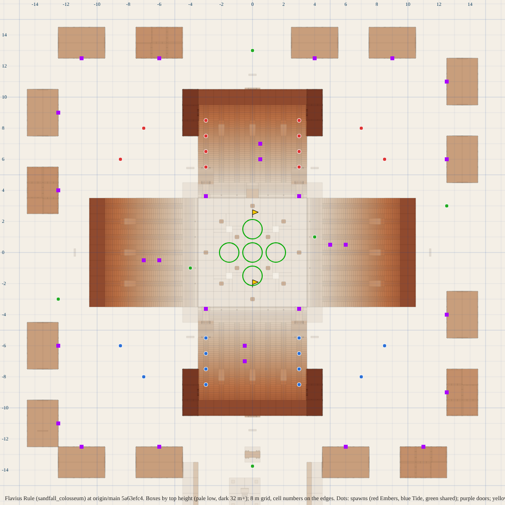
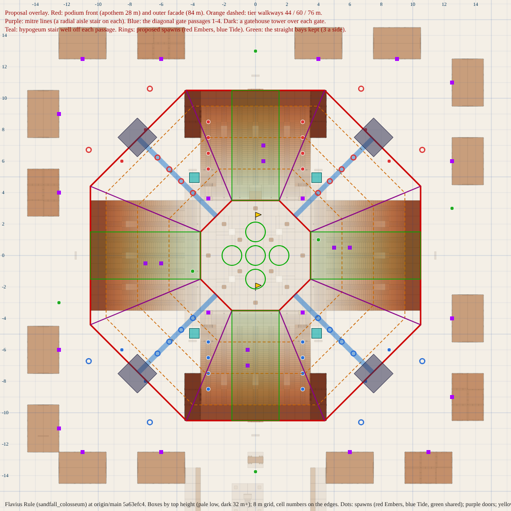

# Flavius Rule as an octagon: plan

| | |
|---|---|
| Map | `maps/sandfall_colosseum.json`. Its display name is **Flavius Rule** (`metadata.name`, checked on origin/main 5a63efc4); the file name and id stay `sandfall_colosseum`. |
| Asked by | The owner, 2026-11-14: a near-regular octagon, angled corner sides about as long as the straight stands, not a one-tile chamfer ("1 b"); the MapMaker lane builds it ("2 a"); a plan first. `docs/QUEUE.md` Features (L). |
| Written by | A helper of lane B's splitters22, 2026-11-14. Plan only: no map or code changes. |
| Rules | CLAUDE.md "Maps": the map changes only in MapMaker, through its own tools; every new piece goes into MapMaker for everyone; no map scripts. |
| Pictures | `octagon/plan-today.png` (the map today, plan view) and `octagon/plan-octagon-proposal.png` (the proposal drawn over it). |

## Summary

- Clip the sand's corners on the 8 m grid. Keep the three middle bays of each straight stand (24 m). Add four 45° corner stands. Their front on the sand is 22.6 m long. The octagon is nearly regular at every depth: 24 / 22.6 m at the sand, 70.4 / 69.0 m at the facade.
- The stands, the hypogeum and the village stay where they are. Only the corners and the end bays change.
- MapMaker gets a family of **Arena Corner** pieces: one tile per storey band, turned in quarter turns like any tile, with their 45° geometry inside. Two set pieces stack them, one plain and one with a gate. Any arena built from the Arena stands pieces can use them.
- The gates move to the middle of the diagonals, where the board has them. They keep their portcullis, winch, chain and rules. A gatehouse tower stands over each gate's outer end.
- Five phases, about six landings. The new pieces land and are tested before the map is touched.

## 1. Today, measured

Measured on origin/main 5a63efc4 with the game's own geometry (`buildMapGeometry`, the same boxes physics uses).

### Footprint and grid
- Standard grid: 8 m cells, 4 m levels. A board square is 4 m, half a cell. The arena's centre is the origin.
- Sand: cells -3..3, 56 × 56 m (±28 m). The 13 × 13 board (52 m) sits in it with a 2 m margin. The podium wall is at ±28 m.
- Stands: four straight stands, seven radial bay lines each (N/S: x = -3..3; E/W: y = -3..3), from the sand out to ±84 m.
- Outside: the ring street, sixteen insulae (cells 13-14 out), the main square south. Terrain 320 m. Boundary x ±148, z -158..148.

### Stand tiers (each straight bay line, depth in cells from the centre)
| Depth | Distance | Level | Piece | Top |
|---|---|---|---|---|
| 4-5 | 28-44 m | 0 | Arena Bay (Podium): 2 m podium wall, walkway, seats, gallery behind | 8 m |
| 6-7 | 44-60 m | 2 | Arena Bay (Upper Tier), gallery under its back half | 16 m |
| 8-9 | 60-76 m | 4 | Upper Tier, or Vomitorium on every other line | 24 m |
| 10 | 76-84 m | 6 | Arena Attic (walk, windows, roof) | 28 m |
| 6-9 | under the tiers | 0-3 | limestone "Stand fill" Sky Blocks (10), except the gate lines' Grand Arcades | |
| 10 | facade | 0, 2, 4 | Grand Arcades on N/S; a plain limestone wall (fill block) on E/W | |

### The corners today
- The stands are straight, so each corner is an open court of 7 × 7 cells (56 × 56 m) at ground level.
- The sand's corner cell, (±4, ±4), is open paving (a Platform tile over the hypogeum ring's corner). So the sand opens into each court through an 8 m gap.
- A Stair Tower (8 levels, 3 × 1 cells, 32 m lookout) stands in each court against the end of the north or south stand, at x ±4, y ±8..10. Its hall opens into that stand's galleries at every level.
- An Open Stairs tile at (±4, ±5), level -1, climbs from the ring's corner up into each court.
- Gates 1-4 are the north and south stands' end lines (x ±3): a Gladiator Gate tile at depth 4, then Grand Arcades out to the facade. Portcullis doors at (±24, ±29), start raised. Winch buttons in the passages, chain buttons on the sand. Eight rules (toggle door, buzzer).

### Collision boxes, lights, nav
| What | Boxes |
|---|---|
| Whole map | 22,240 (the test's cap is 23,000) |
| Straight stands, three middle lines a side (kept) | 4,569 |
| Straight stands, the two end lines each side of each stand (x or y = ±2, ±3) | 7,856 |
| Corner courts (the four towers 3,136, paving 4) | 3,140 |
| Hypogeum | 1,670 |
| Village, sand and the rest | 4,844 |

- By piece: Upper Tier 103 a placement, Vomitorium 119, Podium 79, Grand Arcade 58, Attic 6, Stair Tower 784.
- Lights: 253 of 256. About 80 of them are in the end lines and the towers.
- Nav (2026-11-09): validate-map 0 issues; nav audit 0 traps (islands under the stands and on insula roofs, unreachable). Stuck spots left: the court stairs down into the hypogeum, (±36, -2, ±36) and (-28, -2, -40).
- Bots (24, 240 s, seed 1): TDM 136 kills, stuck recoveries 160; CTF 7 captures, 223; KotH 70 s held, 98; DM 275 kills. Bench: 3.85 ms a tick (p95 9.45) of 16.7.

### Modes and spawns
- TDM (default), CTF (gates 1/2 against gates 3/4), King of the Hill (the five medallions), Deathmatch. 12 v 12, 8-24 players. Medieval weapons.
- Flags at (0, ±18). Hills at (0, 0), (0, ±12), (±12, 0).
- Embers (north), 12: four in each north gate passage, (±24, 0, 44..68); two in each north court, (±56, 0, 64) and (±68, 0, 48). Tide mirrored south.
- Shared: main square, east and west streets, north street, two in the ring tunnel.
- The map's description is out of date: it still mentions lift cages, a beast lift, an aqueduct and a portal.

## 2. The target octagon

### Shape
- Inner vertices at (±12, ±28) and (±28, ±12). Straight fronts 24 m (x or y from -12 to 12). Diagonal fronts 22.6 m, on the line |x| + |y| = 40, which runs through cell corners.
- Apothems: 28 m to the straight fronts, 28.3 m to the diagonals. That is within 1% of a regular octagon.
- Each tier keeps its depth (16 m) all the way round. The tiers meet at mitres, lines at 22.5° from each inner vertex out to the facade.
- So the octagon stays nearly regular at every depth. Straight / diagonal side at 44 m out: 37.3 / 35.9 m; at 60 m: 50.5 / 49.1 m; at 76 m: 63.8 / 62.4 m. At the facade: 70.4 / 69.0 m.
- Outside the diagonal facades, each corner keeps a triangular **outer court** (legs about 49 m). The towers stand there.

### Sizes considered
| Option | Straight / diagonal at the sand | What moves | Size |
|---|---|---|---|
| **A. Clip the sand's corners (recommended)** | 24 / 22.6 m | the end bays and the corners; sand -16% | L |
| B. Grow the arena: stands move out 2 cells, the whole board stays | 40 / 33.9 m | all four stands, the hypogeum ring, the village | XL |
| C. Octagon only at the back: the sand stays square, the corner stands fan out from its corners | 56 / 0 m (79 m at the facade) | the corners only | L |

- A is the only one that is near-regular where players fight and keeps the stands, the hypogeum and the village.
- B doubles the work and moves every other part of the map.
- C does not change what you see from the sand: it still looks square.

### On the grid
- MapMaker's grid is square, and tiles and set pieces turn only in quarter turns. A 45° tier 16 m deep is not a whole number of cells (16 m across is 2.83 cell diagonals), so 45° pieces cannot be small cell tiles.
- So each corner is a few **big tiles**, one per storey band (levels 0-1, 2-3, 4-5, 6-7). Each covers the whole corner and claims its cells only on its own levels, so the four stack with no overlap.
- The boxes inside can turn to any angle. Turned boxes already work in physics, the navmesh, rendering, picking and the plan view (Round Corner pieces, format v8).
- The corner pieces turn in quarter turns, so one piece serves all four corners. Each is its own mirror image across its diagonal, so Mirror gives a turned copy.
- A corner covers cells 2..10 both ways from the centre, less the sand's triangle and the outer court: about 50 cells a storey band.
- The wedges between the end of the kept straight bays (x = 12 m) and the mitres belong to the corner pieces. Their rows run straight, then meet the diagonal rows at the mitre.

### The arena floor
- Sand: 3,136 m² today, 2,624 m² as an octagon (-16%).
- The board loses its corner squares. Per corner, three squares go whole, (20, 24), (24, 20), (24, 24), and three are halved, (16, 24), (20, 20), (24, 16). On the board these are the gate squares, so the gates go to the diagonal. Nothing else stands on them today.
- The twelve pillars, the four hatches, the five medallions, the beast pit and both flags are inside the octagon. They do not move.
- Three sand cells per corner, (±3, ±3), (±2, ±3), (±3, ±2), are under or half under the new podium. Twelve of the 49 Courtyard tiles change (see step 3 in section 4).

### Lines of sight
- On the sand, the longest line falls from 79 m (corner to corner) to 61 m (vertex to vertex). Across the flats it stays 56 m.
- Today you can also see out of the sand's open corners into the courts. That goes, so the sand becomes a closed bowl. That is good for the Medieval weapons and for the look.
- The corner stands add high positions over the sand on the diagonals. They look across at the straight stands, as the straight stands look at each other today.
- The mitre aisles are new climbing lines at each vertex (see 3.2). The corner galleries are covered routes, out of sight of the sand.

### Team balance
- The map stays an exact north-south mirror. Each team keeps two gates and its spawns behind them.
- Gates come closer to the centre: from the gate mouth to the centre hill, 37.6 m today and 29.3 m after. Spawns in the passages are about 45-70 m from the centre (about 50 m today). Fights start a little sooner.
- CTF: a flag at (0, 18) is 26.4 m from its nearer gate today and 20.9 m after. Both teams change alike.
- Ways off the sand: today 4 open corners, 4 gates and 4 hatch ladders. After: 4 gates and 4 ladders. A lowered portcullis would leave only ladders. Question 4 offers podium stairs to keep 8+ ways out.
- King of the Hill and Deathmatch need no changes beyond the spawns.

## 3. What MapMaker needs

All new pieces are general: any map can use them from the palette.

### 3.1 Builders (`packages/shared/src/map/catalog.ts`, data parts)
1. **`turned`**: a group of any parts turned by any yaw about a pivot. It turns each box's centre and adds the yaw, so flights, vaults, columns and rails can stand at 45°. Today only a plain box takes `yaw`; a flight or a vault cannot turn.
2. **`wallRun`**: a wall built from an edge style (wall, Round arch, Grand arch, window) along any segment, not only a cell side. It reuses `edgeSegments`. This puts arches on 45° gallery walls and facades.
3. **A plain collision option for arches** in these new pieces: the voussoirs are drawn as trim, and collision is the piers and one lintel. A Grand arch is about 17 slices today. New pieces only, so no shipped map changes (question 6).
- `tools/content/tiles.mjs` checks the new parts. Kit unit tests cover them.

### 3.2 The corner tiles (`content/tiles/core.json`, palette group Vertical, themed by the slots floor, walls, solids and trim like the Seating Tier)

| Id (proposed) | Levels | Contents |
|---|---|---|
| `core.arena_corner_ground` | 0-1 | podium wall 2 m on the diagonal, its walkway and first seats, the gallery behind (a 45° vaulted corridor with Round arches, joining the straight bays' podium galleries), solid fill under the upper tiers, the facade's ground storey |
| `core.arena_corner_ground_gate` | 0-1 | the same with a Gladiator Gate on the diagonal's centre line: a 3.2 m passage onto the sand (a portcullis opening), out under the stand to the facade; a stair well off it down to level -1 |
| `core.arena_corner_mid` | 2-3 | the Upper Tier round the corner (rows, aisles, gallery under its back half), the podium seats' top, the facade's second storey |
| `core.arena_corner_upper` | 4-5 | the second tier with a vomitorium on the diagonal's centre line, the facade's third storey |
| `core.arena_corner_attic` | 6-7 | the attic walk round the corner, its windows and roof |

- The gate version is a tile option (`optionOf`, as the tunnels' Side walls): an inspector checkbox swaps the tile and keeps its paint.
- **Mitre aisles**: an aisle stair 2.4 m wide along each mitre line. The rows of both sides end under its cheek walls, so no row ends show. Along the mitre the seats climb 0.5 m every 1.08 m, so the steps are 0.25 m high with 0.54 m runs (the kit's rule: at least 0.45 m). The diagonal also gets an aisle on its centre line, or two on the long upper tiers, so no row runs more than about 24 m between aisles.
- Rows can be single long boxes between aisles. That is fewer boxes per square metre than the straight bays, which split every row at each 8 m bay's aisle.
- The galleries continue round the corners at levels 0, 2 and 4, so each storey becomes a ring behind the seats (question 5).

### 3.3 The tower (`core.arena_corner_tower`, levels 0-8, or a part of the gate option)
- A gatehouse over the gate's outer end, turned 45°, straddling the facade. Two switchback stairs either side of the passage, landings onto the galleries at 8, 16 and 24 m and the attic, a lookout at 32 m as today.
- It reuses the stairwell's flights inside a `turned` group. Today's Stair Tower (8) cannot be used: set pieces turn only in quarter turns.

### 3.4 Set pieces (`content/setpieces/arena.json`, family "Arena stands")
- `setpiece.arena_corner`: the four storey tiles and their lights (at most 18).
- `setpiece.arena_corner_gate`: the gate and tower versions, the portcullis door (yaw 45°), its lights.
- Buttons and rules are map logic, not set-piece parts. In the map they stay as they are and move with the gates.
- Explode gives ordinary tiles, doors and lights, as for the straight stands.

### 3.5 Nav and bots
- Aisles 2.4 m clear, as the straight Seating Tier: the navmesh keeps 0.8 m of path. Galleries and the gate passage at least 3.2 m.
- If 45° steps make a ledge for the navmesh, the fallback is the cliff-stair trick: collide as one pitched ramp (26.6°, walkable) and draw the steps as trim.
- **Doors at 45° need a small general fix.** Bot blockers, nav openings and the spawn check use a door's axis-aligned bounds (`sim/scenario.ts` `doorPlane` → `oboxAabb`; `NavWorld.markOpenings` samples that box). A 45° portcullis would block a 2.4 m square, not a 0.2 m slab. Fix: an oriented box for the spawn check, and the oriented footprint for `markOpenings`. Every map with a turned door gains from it.
- Bots press the winch or chain button when a gate is down, as today. Test it at 45°.

### 3.6 Code that changes
- `shared/src/map/catalog.ts` (two parts, the arch option), `tools/content/tiles.mjs`, the generated kit tiles, the palette atlas (`pnpm content:rebuild`).
- `shared/src/sim/scenario.ts` and `shared/src/nav/index.ts` (oriented doors).
- No editor UI code. That keeps clear of the MapMaker UI spec's Phases 2-3 (`packages/client/src/editor/**`). The palette, ghost, inspector, Mirror and Explode already handle big tiles.
- No map format bump is expected: new tile ids are content. If one turns out to be needed, it takes the number after the tunnel kit's v39.
- Shared files: lane A's tunnel kit (steps 5-8) also edits `catalog.ts` and `content/tiles/`. Agree the order in HANDOFF.

### 3.7 Tests
- Kit: `turned` and `wallRun` boxes; plain arch collision.
- Corner tiles (a new `arenaCorner.test.ts`, like `tilesUrban.test.ts` and the bay-line test in `setPieces3.test.ts`): in all four turns, bots path along the galleries from one straight bay through the corner to the next, up each mitre aisle and the centre aisle, through the gate passage onto the sand, down the stair well and up the tower to every level. Mirror equals a turn. The stacked tiles overlap nowhere. The rows meet the straight bays' rows flush.
- z-fight: the stacked corner and its neighbours have no coplanar overlaps left (`coplanarOverlaps` already compares faces across different yaws).
- Doors: a 45° door's blocker and opening are its own slab.
- The coverage map (`maps/test_coverage.json`, placed in MapMaker) carries one corner, one gate corner and the tower; its unit test fails if they are missing.
- `stylePacksAncient.test.ts`: update Flavius Rule's checks in phase 4 (the gates' tiles and doors, the sand's cells, the box cap, the fill blocks).

### 3.8 What is reused
- The Seating Tier's row and aisle numbers, the Gladiator Gate's passage, the stairwell's flights, the vault and arch builders, the edge styles, tile options (`optionOf`), the Arena stands family, the portcullis door, the button rules, the hypogeum as it is, the Stair Tower's layout.
- Not reused: Arena Seating Corner (`imperial.seating_corner`). It is a square L for one cell, not a 45° side.

## 4. The map edits, in MapMaker

Claim `maps/sandfall_colosseum.json` in HANDOFF first. Drive the real MapMaker of a `vite preview` build the way a person does, as for the 2026-11-08 rebuild: Import, select, Delete, the palette, R, PgUp/PgDn, the inspector, Map properties, Export. Commit after each step.

1. **Clear the end bays.** On every level, drag-select the two end lines of each stand (x or y = ±2, ±3, depths 4-10) and delete them. This removes the gate lines and the facade arcades on them. Keep the gate doors, buttons and rules for step 5.
2. **Clear the courts.** Delete the four Stair Towers, the four Platform tiles over the ring's corners, and the four Open Stairs at (±4, ±5), level -1.
3. **Sand.** Delete the twelve Courtyard tiles under the new podium (or keep them if Phase 2 lets the podium stand on them). The other 37 stay.
4. **Place the corners.** Place `setpiece.arena_corner_gate` at each corner, turned with R (NE, NW, SW, SE). Check the ghost is green and the ports meet the straight bays' galleries.
5. **Gates.** Move each Portcullis ("Gate 1" to "Gate 4") into its corner's opening: about (±20.7, 0, ±20.7), yaw 45° steps, still starting raised. Move each winch into the passage and each chain onto the sand beside it, within 4 m of the door. The eight rules stay as they are (they name the same ids). Gate numbers stay by corner: 1 SE, 2 SW, 3 NW, 4 NE.
6. **Hypogeum stairs.** Put each stair down from the gate's stair well to the ring's corner. If the well lands beside the ring corner, turn the ring's corner tile into a T (`core.tunnel_vault_t`) toward it. Flatten the ground there if the nav audit finds the tunnel closed.
7. **Fill blocks.** In the inspector, shorten the ten "Stand fill" blocks from 40 or 56 m to 24 m, so they stop at the kept bays.
8. **Spawns.** Per corner: four along the gate passage, about 45, 53, 62 and 70 m out on the diagonal, facing the sand; two in the outer court. Twelve a team as today. Keep them 2 m or more from the portcullis. The shared spawns stay.
9. **Lights.** Keep the total at or under 256. The corners' set pieces bring at most 18 each, about the 80 freed in steps 1-2.
10. **Map properties.** Rewrite the description (no lift cages, beast lift, aqueduct or portal). Set a card camera that shows the octagon from above at 45°.
11. **Kept:** the 4 m squares, the board's pillars, hatches, medallions and beast pit, the emperor's box, the portcullis logic, 12 v 12, TDM/CTF/KotH/DM, the hypogeum, the village, the volcano, open courts (now outside the facade, reached from the gates and the towers).
12. **Publishing.** The file carries a release (revision 27). After it lands, the owner publishes it again from MapMaker (docs/HOSTING.md, "Publishing maps").

## 5. Risks
- **Collision boxes.** Steps 1-2 remove about 11,000 (7,856 end lines, 3,140 towers and paving). Target: each corner with its tower 2,700 or fewer, so the map stays at or under today's 22,240 (the cap is 23,000). By area each corner is about 8.6 straight bay lines' worth, about 2,600 boxes built the old way. So long rows and plain arch collision are needed to keep it.
- **Lights.** 253 of 256 today. Count the corners' lights before placing them.
- **Performance on the owner's M1.** More seating faces the sand. Box count stays level, but draw calls and shadow casters in the stands may rise. Compare `PERF_STILL=1` before and after. Ask the owner for a short recording on the M1.
- **Nav and stuck spots.** 45° steps, the mitre aisles' ends, the gate stair well, the tower's switchbacks and the passage past a lowered portcullis. The court stairs are today's stuck spots, and they go.
- **Z-fighting** at the mitres (rows of equal height at two yaws), at the sand's half cells and where the corner wedges meet the straight rows. The renderer clips coplanar faces across yaws, and the z-fight audit checks them.
- **Doors at 45°.** Without the oriented door fix, bots treat the gate as a 2.4 m square block, and spawns near it fail the spawn check.
- **Driving MapMaker.** It took 60-80 s a placement on this map in software rendering. About 30 placements and moves; plan for a long session and commit often.
- **The card shot.** The tool picked an aerial from the west. A card camera keeps the octagon readable on the map card.
- **Shared files.** Lane A's tunnel kit touches `catalog.ts` and `content/tiles/`. The MapMaker UI phases touch editor code; this plan does not.

## 6. Checks
- `pnpm validate-map maps/sandfall_colosseum.json`: 0 issues.
- `pnpm nav-audit sandfall_colosseum --pictures=<dir>`: 0 traps, 0 errors, only the known islands.
- z-fight audit (`packages/shared/test/zfight.test.ts`) and `stylePacksAncient.test.ts`.
- `pnpm bot-report sandfall_colosseum --mode=<mode> --seeds=1,2,3 --seconds=240` for TDM, CTF, KotH and DM, compared with the 2026-11-09 numbers. Watch stuck recoveries, captures, hill time, spawn deaths, and idle spells at the gates and stairs (`--spells`). Also `--base=origin/main` for pace.
- `pnpm bench` (24 bots, TDM): stays well under 16.7 ms a tick.
- `PERF_STILL=1 node tools/perf/client-perf.mjs sandfall_colosseum`, low and medium, before and after.
- Card shot: `node tools/content/capture-map-shots.mjs <url> sandfall_colosseum`.
- `pnpm typecheck`, `pnpm test:changed`, `pnpm build` then `pnpm e2e:changed`. Content and shared-map changes may map to many flows; `pnpm ci:plan` shows which. The `flashing` flow is not affected (no new effects).
- The full suite on a `check/` branch before `main`.

## 7. Phases

| # | What | Size | Lands alone? |
|---|---|---|---|
| 1 | Builders `turned` and `wallRun`, plain arch collision, oriented doors; their tests | M | Yes: nothing uses them yet |
| 2 | Corner tiles `ground` / `mid` / `upper` / `attic`, `setpiece.arena_corner`, palette, coverage map, nav tests in four turns | L (1 landing, maybe 2) | Yes: new pieces only |
| 3 | Gate option, stair well, tower, `setpiece.arena_corner_gate`; their tests | M | Yes |
| 4 | Flavius Rule in MapMaker (section 4), its checks, the test updates, the card shot | L (1 landing) | Needs 2 and 3 |
| 5 | Tuning from the bot reports (stuck spots, spawns, lights) | S | After 4 |

- Phases 1-3 can be checked on the coverage map and a scratch map before Flavius Rule is touched. The owner can look at a corner in MapMaker after phase 2.
- Phase 1 is small enough to go with phase 2 if the landing slot is short.

### Phase 1: as built (2026-11-14, `wip/flavius-octagon-1`, lane B's splitters22)
- **`turned`** (`map/catalog.ts` `TurnedPart`, `turnBoxes`): a group of any parts turned by `turns` (quarter turns: 0.5 = 45°) or `yaw` (radians) about `pivot` (default [0, 0]). Centres turn, yaws add, sizes stay; on whole quarter turns plain boxes stay plain (so 90° is exactly the parts built the other way, and two 45° groups nested make a plain 90° one). Groups nest.
- **`wallRun`** (`WallRunPart`, `wallRunBoxes`): an edge style along any segment, `bays` along it; the segment is the outer face, the thickness `left` (default, as a cell side), `right` or `centre`; `y`, `height` (default 4), `outer` (default true). Along a cell's side, at every quarter turn, its collision and trim equal what that side builds (tested for wall, Round arch, Grand arch and window on all four sides).
- `edgeSegments` and `edgeTrimBoxes` moved, unchanged, from `map/geometry.ts` to a new `map/edgeShapes.ts` (geometry re-exports them), so the catalog can build from them while it loads (geometry imports the catalog).
- **Plain arch collision** (`wallRun.plain`): piers plus one lintel from the crown up; the steps over the curve become trim drawn in the walls' paint (new `LocalBox.paint` / `WorldBox.paint: 'walls'`, read by `faceSlot`), so the arch looks the same. Round and Grand arch: 19 collision boxes → 3. Near each pier the stone between the curve and the crown is drawn but passable (up to about 1.3 m on a Round arch, 1.8 m on a Grand arch, right at the pier).
- **Oriented doors:** `Aabb.obox` (sim/scenarioDefs.ts `orientedAabb`) carries the turned slab for a door off the grid; `segmentHitsAabb` (bot blockers, the button's door), `bodyInAabb` (`Scenario.inShutDoor`, the spawn check) and `NavWorld.markOpenings` (13 × 2 samples over the slab, not 10 × 10 over its 2.4 m square) use it. On-grid doors carry none and run exactly the old code.
- `tools/content/tiles.mjs` checks both parts (and the parts in a group); `tools/content/test/tiles.test.mjs` covers it.
- **No shipped map changed:** every map's collision boxes, drawn trim and door planes hash the same as on origin/main dc504c9e (89 maps, 157,199 boxes, 105,100 trim, 296 doors; none off the grid); `octagonKit.test.ts` also checks every map's doors.
- Visual check: a scratch tile (not committed) with a 45° `turned` flight, a 45° plain Grand arch run and a 45° Round arch run of two bays, in the game's renderer; physics probes through the plain arch (opening clear at 2 and 6 m, the lintel and piers solid).

### Phase 2: as built (2026-11-14, `wip/flavius-octagon-2`, lane B's splitters22)
- **Tiles** `core.arena_corner_ground` (levels 0-1), `_mid` (2-3), `_upper` (4-5), `_attic` (6-7), palette group
  Vertical, themed by the slots floor, walls, solids and trim. Each claims only its own two levels; placed relative
  (each tile's cells are its levels 0-1), the set piece stacks them at 0, 2, 4 and 6. Made by a generator,
  `tools/content/kit/arenaCorner.mjs` (hooked into `tools/content/tiles.mjs` like the tunnel kit), not by hand in
  `content/tiles/core.json`: the numbers are the Seating Tier's and the plan's, and the parts are the kit's (box,
  flight, `wallRun`, `turned`).
- **Frame:** the anchor is the sand's corner cell (x and z 12..20 m from the arena's centre for the north-east corner);
  the tile covers 63 cells of the 9 × 9 east and north of it. The two half-sand cells either side of the diagonal's
  front are not claimed at level 0 (they hold only the podium's edge), so the map's Courtyard tiles there can stay
  (§4 step 3: only the corner cell itself goes). The cell under the podium at (±3, ±3) is claimed.
- **Geometry** as §2 and §3.2: depth = max(z − 28, x − 28, (x + z − 40) / √2); podium 0-8 m deep as Arena Seating; 40
  rows of 0.5 by 1 m from 4 to 24 m, one box each between aisles; mitre aisles 2.4 m clear between 0.5 m cheeks
  (steps 0.25 by 0.54 m along the mitre, at 22.5° to both sides' rows); a centre aisle (the Seating Tier's) except on
  the upper tier's front half, where the vomitorium is (passage 3.2 m, an aisle stair 2.4 m either side). Rows on the
  diagonal run up to 28 m between aisles at the very back of the upper tier (19 m at its front, 22 m beside the
  vomitorium), a little over the "about 24 m" of §3.2 at the back; the wedge rows are 2-18 m.
- **Galleries round the corners** (5a) at levels 0, 2 and 4: vaulted (as a vaulted room's), front wall plain, back
  wall Round arches, blind against the fill at 0 and 2, open into the facade arcade's upper storey at 4 (its bays
  share the arcade's inner wall's line so the arches line up); the top gallery's front wall has a Round arch on the
  centre line for the vomitorium. The facade is two-storey Grand arcades all round (levels 0, 2, 4) and the attic walk
  (windows, roof slab, a 0.6 m parapet in level 7). Plain collision (6a) on every arch.
- **Mitres:** where two sectors meet, each box runs to the mitre at its deeper edge; the bit past it at its shallower
  edge lies inside the neighbour's box of the same band (same height). No coplanar faces are left drawn twice
  (`coplanarOverlaps` over `visibleFaces`, every turn, with the straight bays either side).
- **Mirror:** each tile is its own mirror image across the diagonal. New `tileDiagonalMirror` (map/setPieces.ts): a
  set piece mirrored with such a tile places it turned 3 − r at the mirrored anchor (its edge keys swapped across the
  diagonal), so M on the Arena Corner gives the corner turned. The selection Mirror tool (editor/mirror.ts, held for
  the MapMaker UI work) still refuses the exploded tiles.
- **`setpiece.arena_corner`** (`content/setpieces/arena.json`): the four tiles (roles: floor paving, walls and solids
  stone, trim) and 13 lights (a candle on each gallery's front wall in each sector, two on the top gallery's diagonal
  beside the vomitorium's arch, a chandelier over the attic in each sector). Ports (openings) where the galleries, the
  arcades and the attic meet the straight bays.
- **Budget:** collision 343 + 428 + 456 + 69 = **1,296 boxes** a corner (target: well under 2,700 with the tower);
  trim 2,022 + 2,230 + 2,453 + 90 = 6,795 (the plain arches' steps and the arcades' dressing are most of it). The
  generated kit table grows by about 70 KB (`kitTiles.generated.ts`).
- **The 45° steps:** no navmesh ledge, so no ramp fallback: bots climb the 22.5° mitre steps and the 45° centre steps.
- **Tests** (`packages/shared/test/arenaCorner.test.ts`, the corner between a straight bay line of each stand with the
  fill blocks, in all four turns): bots walk each gallery from the north stand round the corner to the east stand at
  its own height and through the diagonal; up both mitre aisles (five points to depth 44, each by a path at most 1.35
  times the climb) and the centre aisle to the vomitorium's mouth, through it into the top gallery; the attic. Rows,
  walkways and floors meet the straight bays' within 1 mm along both joins, depth 0-55 m. Mirrored equals turned
  (boxes, trim, lights). The four tiles' boxes overlap nowhere (separating axes). Exploded equals placed.
  `setPiecePlay.test.ts`'s z-fight audit places pieces over 4 cells wide in maps of their own (every turn and
  mirror); `tilesData.test.ts`'s fixture holds the four tiles by a hash. The coverage map carries one corner (placed in
  MapMaker; its test requires it like every set piece and kit tile).
- **Not done (phase 3):** the gate option, its stair well, the tower. Not checked: the vomitorium's side stairs for bots
  (as in the straight Vomitorium bay, they start from a 1 m row the navmesh doesn't hold; bots reach the upper centre
  aisle from the attic), a match on a map with corners, the M1.

### Phase 3: as built (2026-11-15, `wip/flavius-octagon-3`, lane B's splitters22)
- **The Gate option** (§3.2's gate row): `core.arena_corner_ground_gate` and `core.arena_corner_attic_gate`, MapMaker
  tile options of the ground and attic storeys (`optionOf`, new option id `gate`: label "Gate" in
  `shared/editor/tileVariants.ts`, `map/catalog.ts` TILE_OPTIONS, `tools/content/tiles.mjs`); same cells and ports,
  hidden from the palette, the inspector's checkbox swaps them keeping place, turn and paint. No map format change.
- **The gate** (ground, Gate): a Gladiator Gate on the diagonal's centre line, its passage 3.2 m wide: 3 m clear under
  the gatehouse block at the podium's face (the portcullis hangs 1 m in), roofed at 3.2 m through the podium (timber
  beams as trim), across the podium gallery (a lintel in the front wall; the back wall has five Round-arch bays, one
  on the centre line), 3.4 m high through the fill (carved out of the fill bands: `carvedBand`, a greedy box merge)
  and out through the facade's middle Grand arch (the ground arcade's inner face has nine bays, one on the centre line).
- **Stair wells** (3a): one either side of the passage, 2.4 m wide; a door off the passage 29-31.4 m in, sixteen steps
  down toward the sand to level -1, a foot landing square to the grid that meets tile cell (2, 2, -1) (the hypogeum
  ring's corner, today a Junction toward the court stairs) on its north and east sides through 3.6 m openings, the
  width of a Vaulted Tunnel. Both, so the tile stays its own mirror image: §4 step 6 then wants a Vaulted Tunnel
  Crossing at the ring's corner (or a Junction toward one well, the other ending at a wall). The wells hang a level
  under the tile's cells (no cell at level -1 is claimed: a set piece's levels are one range, so claiming -1 would
  claim it under the whole corner, where the hypogeum is). A `bore` cut takes the ground's surface out round them.
- **Podium stairs** (4b): eight steps against the podium wall on the sand either side of the mouth (3 to 7 m off the
  centre line, 2.4 m out onto the sand) and a landing level with the wall's top (2 m); the parapet is left off over
  their tops. Recessed into the podium (first built that way) the navmesh lost them: a 2.6 m recess walled at both
  ends leaves no foot it can reach.
- **The gatehouse tower** (2a): its own tile, `core.arena_corner_tower` (Vertical), not part of the gate option (the
  option's cells must be the plain tile's, and the tower stands in the outer court up to level 8). It stands against
  the facade's outer face from depth 56 to 66.1 m, turned 45°, as wide as the facade's middle three bays (23 m, its
  sides on the piers), so the middle and upper storeys keep their facade and their Grand arches open into its landings;
  only the attic needed the option (no windows or parapet over those bays). The passage runs through its foot; a hall
  on the facade side, then a switchback either side of the passage (lane A up 2 m outward, a half landing, lane B up
  2 m back); a landing crosses the tower every 4 m: the arcade storeys at 8 and 16 m (through the arches), the attic
  walk at 24 m and its roof at 28 m, the lookout at 32 m with a 1.2 m parapet (merlons drawn only). Steps 0.25 by 0.5 m,
  4.45 m wide, each 0.6 m deep under its tread so the flight 4 m below keeps 3.4 m of headroom. Built with `turned`
  like the corner. It claims the outer court's cells under it at levels 0-7 and all of level 8.
- **`setpiece.arena_corner_gate`** (Arena stands family, `content/setpieces/arena.json`): the ground and attic Gate
  tiles, the middle and upper tiles, the tower, a portcullis door at (4.707, 0, 4.707), yaw 45° (phase 1's oriented
  doors; starts raised, opened by logic only) and 18 lights (the plain corner's 13, its diagonal gallery candle moved up
  onto the lintel, a chandelier in the passage, a candle at each well's head, two on the tower's core). Footprint: the
  plain corner's cells and the tower's five, levels 0-8. Buttons and rules stay map logic.
- **A phase-2 fix:** the ground storey (plain and Gate) has ports on the four sides of its cells that face the two
  half-sand cells, (1, 1) west and south, (0, 2) south, (2, 0) west. Before, the sand's Courtyard tiles there built
  their auto walls on those sides, 4 m high, up through the podium's walkway and seats (unseen in phase 2's tests,
  which never walked the podium walkway); with the gate they closed its mouth. Open ground now meets open ground.
- **Budget:** collision 448 + 428 + 456 + 58 + 291 = **1,681 boxes** for a gate corner with its tower (target: well
  under 2,700); trim 2,122 + 2,230 + 2,453 + 72 + 40 = 6,917; 18 lights. A plain corner stays 1,296.
- **Tests** (`packages/shared/test/arenaCornerGate.test.ts`, its map in `arenaCornerGateMap.ts`: the gate corner between
  straight bay lines with the fill blocks, the hypogeum's corner a Crossing a level down, in all four turns): bots path
  from the sand through the passage out through the facade and the tower's foot (staying on the ground, at most 1.15
  times the straight line); down each well from its head to the ring's corner and back; up the tower to every landing
  and the lookout, and off the landings onto the arcades (8, 16 m), the attic walk and its roof; up both podium stairs
  (on their steps) to the walkway and the top walkway. The shut portcullis blocks its own slab (the podium stair's foot
  beside it stays clear) and keeps spawns out of the slab only; open, bots go through; shut, a bot after a gun behind it
  presses its chain button and goes through (all four turns). The Gate checkbox swaps and keeps paint. Mirrored equals
  turned (boxes, trim, lights, door); the five tiles overlap nowhere; no coplanar faces; exploded equals placed; on
  terrain the bore keeps the wells clear (without it the ground lies across the flight). The coverage map carries one
  gate corner (placed in MapMaker); its unit test requires every set piece and kit tile, option twins included.
- **Not done (phase 4):** Flavius Rule itself. Not checked: a match on a map with the gate corner, the M1.

### Phase 4: as built (2026-11-15, `wip/flavius-octagon-4`, lane B's splitters22)
- **Driven in the real MapMaker** (a `vite preview` build, Playwright as a person: Import, the Select tool's drag-box,
  Delete, clicks, the Set pieces palette, R, the inspector's fields, the tile type select, the set piece's Parts list,
  Map settings, Set card shot, Export). No map JSON edited by hand; no editor code changed.
- **The tower's faces** (owner's phase-3 answer 3a): arrow slits and a string course on `core.arena_corner_tower`
  (`tools/content/kit/arenaCorner.mjs` `towerFaces`), drawn only: its collision is phase 3's exactly (291 boxes,
  hashed in `arenaCornerGate.test.ts`), trim 40 → 60. Palette pictures re-rendered.
- **Step 1-2, cleared:** on levels 0, 2, 4 and 6 a drag-box from each corner's outer edge over the two end lines of
  each stand and the court (8 boxes a level, each deleted at once): 116 set pieces (the end lines' podiums, tiers,
  vomitoria, arcades and attics, the four Stair Towers), the four Gladiator Gate tiles, the four Platform tiles over the
  ring's corners and the four court Open Stairs (they reach level 0); the eight legion standards on the end bays'
  podium walls, one by one. The map's logic, spawns and pickups were hidden (View → map layers) so the box kept them.
  (A first try with Shift-added boxes over many levels caught the selection's rotate ring and moved pieces; it was
  thrown away by importing again.)
- **Step 3, the sand:** the four Courtyard tiles on the corner cells (±3, ±3) deleted; the half cells beside them stay
  (45 sand cells: 33 Courtyard + 16 Corner Hatch less 4). Sand 3,136 → 2,624 m².
- **Step 4, the corners:** `setpiece.arena_corner_gate` at (2, 2) R0 (north-east), (2, −2) R1, (−2, −2) R2, (−2, 2) R3,
  each ghost green. Their own portcullis (part 5) is unticked in each placement's Parts list (`overrides.hide: [5]`),
  so the map's Gate 1-4 doors and rules carry on.
- **Step 5, gates:** Gate 4 (NE) (20.707, 0, 20.707) facing 45°, Gate 1 (SE) 135°, Gate 2 (SW) 225°, Gate 3 (NW) 315°:
  the set piece's own slab, 1 m in from the podium's face, still raised at the start. Winches in the passage 3.5 m in,
  1.1 m off the centre line, facing across it (NE (21.7, 23.25)); chains on the sand against the podium 2.6 m to the
  side (NE (17.88, 21.56)), the others mirrored; each within 3 m of its door. The eight rules are unchanged.
- **Step 6, hypogeum:** the ring's four corner tiles (±4, ±4, −1) turned from Junction into **Vaulted Tunnel Crossing**
  in the inspector (owner 1a), keeping their paint; open to both stair wells. No ground flattening was needed (nav
  audit).
- **Step 7, fill:** the ten "Stand fill" blocks 24 m along their stand (N/S width, E/W depth).
- **Step 8, spawns** (7a): the same 24 team spawns moved. Per corner, four on the gate passage's centre line at
  37.48, 43.84, 49.5 and 53.2 m along each axis (53, 62, 70 and 75 m from the centre; the innermost first went at
  31.8 m, over the hypogeum's lowered ground, which validate-map flags as no floor), facing the sand; two in the outer
  court at (52.5, 78) and (78, 52.5) (mirrored), clear of the tower. Pickups moved off the new podium: grenades
  (±20, ∓20) → (±20, ∓12); health (±56, ±56) → (±72, ±72); spears (∓60, ±56) → (∓74, ±70).
- **Step 10, Map settings:** the description rewritten (no lift cages, beast lift, aqueduct or portal); a card camera
  at (−70, 120, −150), yaw 0.44, pitch −0.68 (the octagon from the south-west, eye level off). Modes unchanged: TDM
  (default), CTF, King of the Hill, Deathmatch; 12 v 12, 8-24 players.
- **Kept:** 4 m squares, the board's pillars, hatches, medallions and beast pit, the emperor's box, the hypogeum, the
  village, the volcano. The file saves at map format v39 (MapMaker's own).
- **Budget:** collision boxes **22,240 → 17,900**; drawn trim 29,811 → 43,379; lights 253 → 245 of 256; doors 28.
- **Checks:** validate-map 0 issues; nav audit 0 traps, 0 errors, islands 14 (9,025 m²) → 15 (11,017 m²): the new one
  is the middle gallery ring (level 2, depth 24-32), which now has no way in (see the questions); `stylePacksAncient`
  updated (gate corners, crossings, 45 sand cells, gates on the diagonals, fill at 24 m, box cap 20,000, spawns,
  description). Bench (24 bots, TDM, 60 s, load ~12): 3.42 → 3.62 ms a tick (p95 7.77 → 7.92) of 16.7.
- **Client perf** (`PERF_STILL=1`, SwiftShader, mean of the four still views; old map built the same way): low draw
  calls 185 → 185, triangles 1.18 → 1.28 M; medium draws 212 → 205, triangles 1.29 → 1.39 M, shadow casters 96 → 88.
  Not measured on the owner's M1.
- **Pictures** (the session's scratchpad `oct4-shots/`): MapMaker's plan before and after, an aerial before and after,
  eye level from the sand toward the north-east gate and the south-east one, the north-east tower's lookout and outside
  face, a match, the card picture (`packages/client/public/maps/shots/sandfall_colosseum.jpg`, retaken from the card
  camera).
- **Bots** (bot-report, 24 bots (DM 16), 240 s, seeds 1/2/3; stuck recoveries before → after): TDM 75/56/106 →
  86/47/83 (kills 147/166/106 → 156/112/138); CTF 234/324/232 → 148/261/161 (captures 6/4/6 → 7/8/9, tide 0/0/1);
  King of the Hill 118/104/99 → 126/95/131 (hill held 37/74/65 → 77/94/68 s); Deathmatch 42/79/117 → 28/28/41. The
  old court stairs' stuck spots are gone. New ones: the gate passage where it crosses the podium gallery (about
  (±24, 0, ±24..28); KotH 130 of its listed recoveries, "cover" and "fight"), a south-east stair well in one CTF match
  ((40, −2, −35), 98 recoveries of a flag runner), the hatch halls as before. The towers and podium stairs barely show.
- **Not done (phase 5):** the stuck spots above; the middle gallery's way in; the M1.

### Phase 5: as built (2026-11-15, `wip/flavius-octagon-5`, lane B's splitters22)
- **The gallery stairs** (owner's phase-4 answer 1a): in `tools/content/kit/arenaCorner.mjs` ("the gallery stairs",
  `GSTAIR`), so the plain corner and the gate corner both have them, in every turn. Two a corner, one in each half of
  the diagonal (each tile stays its own mirror image), in the diagonal's frame at u ±(4.95..15.35): through the ground
  gallery's back wall at its second arch from each mitre (u ±14.35, 3.2 m opening), 16 steps (0.25 by 0.5 m, 2.4 m
  wide) up along the depth through the fill (16 → 24 m) to a landing at 4 m under the middle gallery's front wall, then
  16 steps along the gallery toward the centre line (depth 24.5-26.9) up through a hole in the middle gallery's floor,
  arriving level with it at u ±4.95. A 1 m parapet, 0.2 m thick, runs along the hole's gallery side and across its foot;
  the gallery keeps 4.4 m clear beside it. The lower flight stays 0.25 m clear of the north wedge's fill (which reaches
  u -15.6 at depth 18.3) and the upper one clear of the gate's stair wells (u ±2.1..5, under level 0).
- **The plain corner's ground gallery back wall** now has five bays like the gate corner's (it had four), so the stair's
  arch stands in the same place on both; the plain ground storey's trim 2,022 → 2,066.
- **How:** the flights are kit `flight`s; the fill bands are carved round them with `carvedBand` (holes `STAIR_HOLES`,
  with the gate's `GATE_HOLES` on the gate option), the middle floor slab likewise (`STAIR_TOP`); the parapet is two
  boxes in the mid tile. No new part kinds, no map format change, no editor code.
- **Budget:** collision a plain corner 343 + 428 + 456 + 69 = 1,296 → 420 + 437 + 456 + 69 = **1,382**; a gate corner with
  its tower 1,681 → 524 + 437 + 456 + 58 + 291 = **1,766**. Flavius Rule **17,900 → 18,240** (trim 43,379 and lights 245
  unchanged); the coverage map 14,782. No lights added (the map has 245 of 256): the stairs are lit by the galleries'.
- **Tests:** `arenaCorner.test.ts` (all four turns): bots go from the ground gallery up each stair into the middle
  gallery and back down, by that stair (under 40 m, never over 8.6 m), and the parapet stops a fall into the hole.
  `arenaCornerGate.test.ts` (all four turns): bots go from the sand through the gate passage up each stair into the
  middle gallery and back, on that stair's flights. Re-hashed on purpose: `tiles-resolved.json`'s
  `core.arena_corner_ground`, `_mid` and `_ground_gate`; the tower's collision hash is unchanged. Palette pictures
  re-rendered (`pnpm content:rebuild`).
- **Flavius Rule:** no map edit (its corners are set pieces). validate-map 0 issues; nav audit 0 traps, 0 errors, islands
  15 (11,017 m²) → 14 (9,025 m²): the middle gallery ring joined; z-fight audit passes.
- **Bots** (bot-report, 24 bots, 240 s, seeds 1/2; before → after): TDM stuck recoveries 86/47 → 111/87, kills 156/112
  → 184/160, idle 20.0/29.1 % → 12.1/14.6 %; King of the Hill stuck recoveries 126/95 → 103/90, hill held 77/94 →
  65/77 s, kills 192/233 → 196/205. None of the listed stuck spots is on the new stairs (they are the gate passage by the
  podium gallery and the hatch halls, as in phase 4).
- **Pictures** (session scratchpad `oct5-shots/`, device scale 2): the stair from the ground gallery, the middle gallery
  with the stair's opening and parapet, looking down the stair from the top.

## 8. The owner's decisions

1. **How big is the octagon?**
   - a) Clip the sand's corners: three straight bays a side (24 m) and 22.6 m diagonals. The sand loses 16% and the board its corner squares. Stands, hypogeum and village stay. **Recommended.**
   - b) Grow the arena: the stands move 16 m out so the whole board stays. 40 m straight and 34 m diagonal. The stands, the hypogeum ring and the village are rebuilt.
   - c) Only the back is octagonal: the sand stays square, the corner stands fan out from its corners.
2. **Towers?**
   - a) A gatehouse tower over each gate's outer end, turned 45°, stairs to every tier, a 32 m lookout (the seating chart's dark towers over the gates). **Recommended.**
   - b) Today's Stair Tower, square-on in each outer court, joined to the stand by a short passage.
   - c) No towers: stairs inside the corner stands only.
3. **Hypogeum stairs from the corners?**
   - a) A stair well off each gate passage, down to the ring's corner, inside the stand. **Recommended.**
   - b) Out in the new outer courts, with tunnels run on under the corner stands.
   - c) None: the four branch stairs and the four hatches are enough.
4. **Ways onto the sand?**
   - a) Gates and hatches only, as on the board.
   - b) Also a short stair up the podium wall either side of each gate (eight more ways off the sand, open even when a portcullis is down). **Recommended.**
   - c) Also a stair up the podium wall at each of the eight vertices.
5. **Galleries round the corners?**
   - a) Yes: at levels 0, 2 and 4 the galleries continue round the corners, so each storey is a ring behind the seats. **Recommended.**
   - b) No: solid fill under the corner seats, galleries stop at the corners (fewer boxes, fewer routes).
6. **Collision for the new arches?**
   - a) Plain collision (piers and lintel; the voussoirs only drawn), new pieces only. **Recommended.**
   - b) Plain collision for every Grand arch in the game too: about 7,000 boxes off this map, and other maps change.
   - c) Full collision, like today's pieces.
7. **Spawns?**
   - a) Four along each gate passage and two in each outer court: twelve a team, as today. **Recommended.**
   - b) All in the outer courts, none in the passages.
8. **Order?**
   - a) The pieces first (phases 1-3, each landing alone), then the map. **Recommended.**
   - b) Everything in one landing.

### The owner's answers (2026-11-14: "Recs")
1a (clip the sand's corners), 2a (gatehouse towers at 45°), 3a (stair wells off the gate passages), 4b (short stairs up the podium either side of each gate), 5a (galleries round the corners), 6a (plain arch collision, new pieces only), 7a (twelve spawns a team, passages and courts), 8a (the pieces first, phases 1–3 landing alone, then the map). Phase 4 also brings the map's description up to date (it still mentions lift cages, a beast lift, an aqueduct and a portal).

### The owner's answers on phase 2 (2026-11-14: "Recs")
1a: the half-sand cells either side of the diagonal's front stay unclaimed. 2a: the upper tier's back rows stay as built (up to 28 m between aisles). 3a: the vomitorium's side stairs stay as they are; bots use the aisles. 4a: the selection Mirror (Shift+M) learns diagonal symmetry as a small follow-up once the editor code is free.

### The owner's answers on phase 3 (2026-11-15: "Rec works")
1a: a Vaulted Tunnel Crossing at the hypogeum ring's corner takes both stair wells. 2a: the wells stay below unclaimed cells; documented. 3a: the tower's outside faces get arrow slits and a string course, drawn only (no collision), in phase 4. 4a: the podium stairs stay as built, 2.4 m out on the sand.

### The owner's answers on phase 4 (2026-11-15: "1a 2b 3b 4a")
1. The sealed middle gallery ring: (a) phase 5 adds a stair up into it from the ground gallery at each corner, in the kit.
2. The new bot stuck spots (gate passage by the gallery, one stair well): (b) left as they are.
3. CTF favours Embers: (b) left as it is.
4. Publishing: (a) the owner republishes from MapMaker once phase 4 lands.

Phase 5 is therefore only the gallery stairs.

**Owner, 2026-11-15, on the stairs' lighting:** "Leave": no candles on the gallery stairs (Flavius Rule stays at 245 of 256 lights; the gate corner's 18-light cap unchanged).
